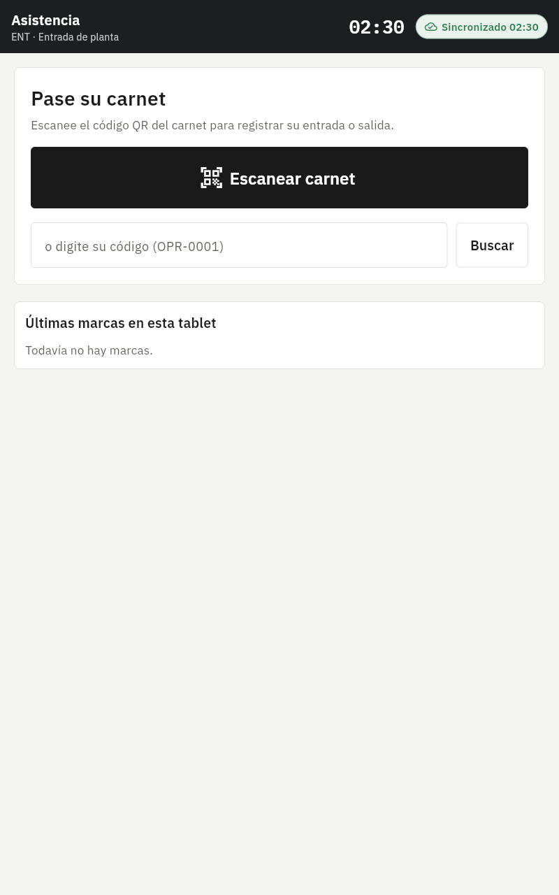
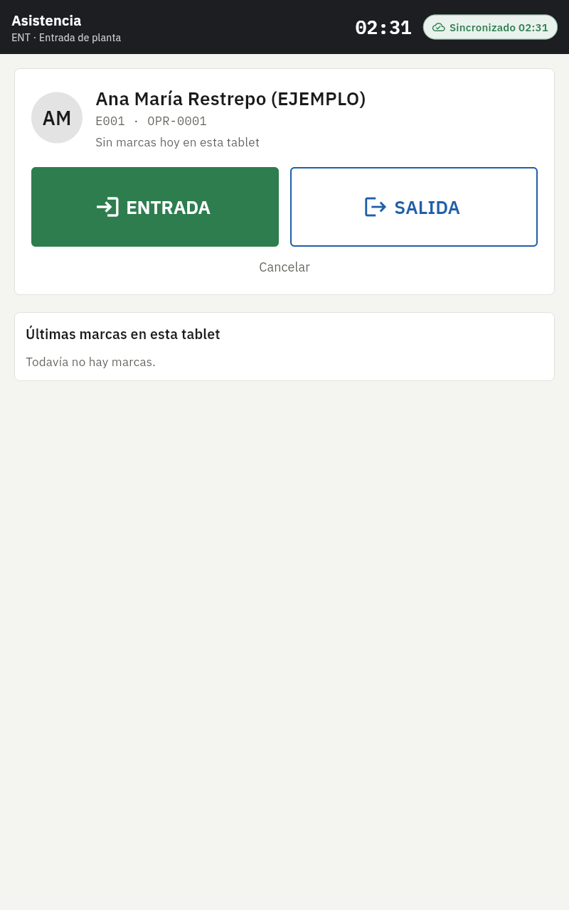
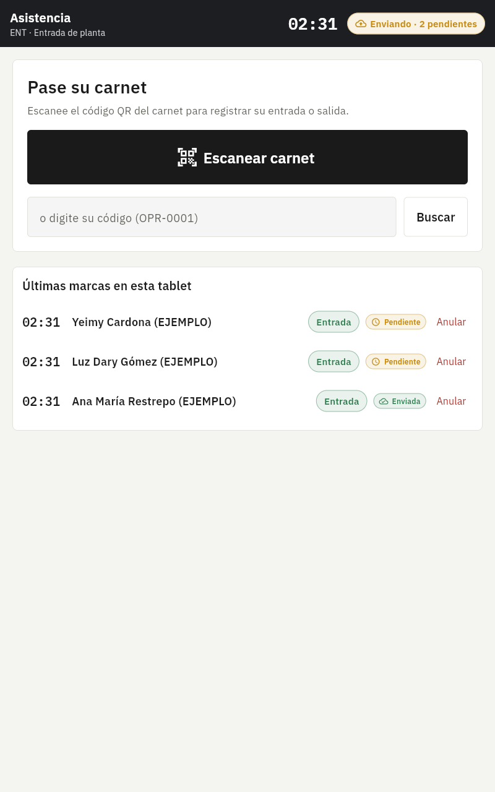
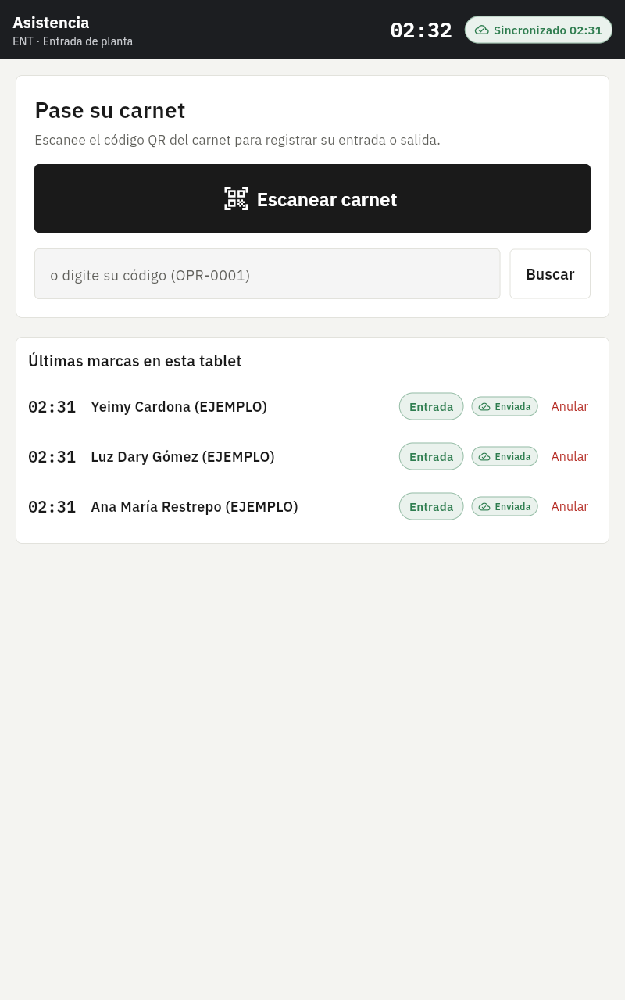
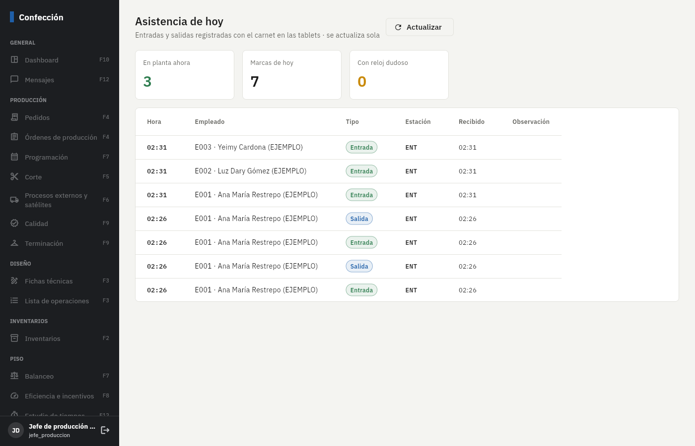

# Fase 1: base del sistema

**Estado:** terminada el 3/nov/2026. Falta tu revisión.

## Qué incluye

| Parte | Detalle |
|---|---|
| Base de datos | 5 migraciones: seguridad y roles, maestros (empleados, células, turnos, festivos, máquinas, tallas, colores, bodegas, proveedores, satélites, clientes, estaciones, dispositivos), ingesta de eventos, RLS y datos de sistema. |
| Reglas | Eventos inmutables (trigger), auditoría con antes/después/usuario/dispositivo, permisos por rol y módulo, nómina separada, consecutivos que nunca se repiten. |
| Sincronización | PowerSync (descarga) + RPC `ingerir_eventos` (subida idempotente por UUID). Desfase de reloj medido en cada envío; hora corregida y alerta si supera 5 min. |
| App de planta | Vincular tablet, descarga de su estación, **asistencia con QR del carnet** (caso de prueba de la sincronización), anulación con motivo, bandeja de pendientes, indicador "Sin conexión · N pendientes / Sincronizado hh:mm", aviso de pendientes > 8 h y de hora desfasada. |
| Panel web | Ingreso, menú lateral oscuro según los permisos del rol, inicio con alertas, personal, asistencia del día en vivo (Realtime), configuración (usuarios, tablets, eventos rechazados). Sin internet muestra el último dato guardado. |
| Datos de ejemplo | 14 empleados, 3 células, 9 máquinas, tallas, colores, bodegas, festivos 2026–2027 y 5 usuarios. Todo marcado **EJEMPLO**. |

## Pruebas automáticas (todas pasan)

- **33** pruebas de base de datos: inmutabilidad, duplicados, rechazos con motivo, hora futura, reloj desfasado, suplantación de tablet, permisos por rol (bodega, satélite, jefe, gerencia), auditoría y consecutivos.
- **13** pruebas de la app: formato colombiano y bandeja sin conexión sobre SQLite real (corte de red, reenvío sin duplicar, sobrevive al cierre de la app, rechazo visible sin bloquear la cola, aviso de 8 h, cambio de hora de la tablet).
- **1** prueba de punta a punta con Supabase + PowerSync reales en Docker: la tablet registra sin red, se conecta, descarga solo su estación, sube y el servidor guarda cada marca una sola vez.

Además se verificó a mano en el navegador (tamaño tablet 800 × 1280): dos marcas hechas **con la red cortada**
quedaron pendientes y llegaron al servidor al reconectar, con su hora original.

## Cómo probarlo paso a paso

1. Siga las secciones 1 a 4 del [README](../../README.md): Flutter, Supabase, PowerSync y `config/dev.json`.
2. **Panel web:** `flutter run -d chrome -t lib/main_web.dart --dart-define-from-file=config/dev.json`
   - Ingrese con `gerencia@ejemplo.co` y la contraseña que imprimió el script. Revise Personal y Configuración.
   - Salga e ingrese con `jefe.produccion@ejemplo.co`: el menú cambia y Configuración dice "Sin acceso".
3. **Tablet:** instale el APK (README sección 6) o conecte la tablet por USB y ejecute `main_planta.dart`.
   - Vincule con `tablet-ent@planta.local`. Verá "Asistencia · ENT · Entrada de planta".
   - Digite `1` y toque ENTRADA. En el panel web (Asistencia) aparece en segundos.
   - **Prueba sin conexión:** active el modo avión, marque `2` y `3`. El indicador dice "Sin conexión · 2 pendientes".
     Cierre la app por completo, ábrala de nuevo: siguen ahí. Quite el modo avión: pasan a "Enviada" y aparecen en la web con su hora real.
   - **Anular:** toque "Anular" en una marca, escriba el motivo. Queda tachada en la tablet y en la web.
   - **Hora desfasada:** cambie la hora de la tablet 20 minutos y marque. En Configuración (web) la tablet aparece con el desfase en rojo y se crea una alerta en el inicio.

## Capturas (vista previa en navegador, datos de ejemplo)

| Tablet: inicio | Tablet: empleado | Sin conexión | Reconectada |
|---|---|---|---|
|  |  |  |  |

## Pendientes y decisiones

- **No llegaron las capturas del diseño.** Seguí los colores y tipografía del prompt; ajusto apenas las tenga.
- **APK no compilado aquí** (el entorno no permite descargar el SDK de Android). El código de Android está listo; compílelo con el README sección 6.
- PowerSync cambió su formato de reglas a **Sync Streams (edición 3)**; `sync/sync-rules.yaml` ya usa el nuevo.
- Crear usuarios desde la web requiere una Edge Function con la service_role; queda para la Fase 2. Hoy se usa el script.
