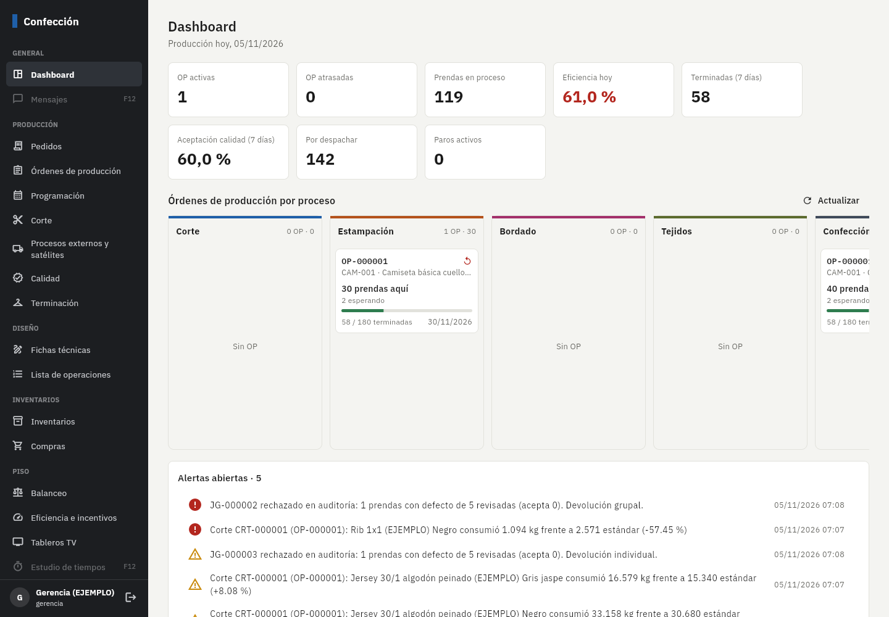
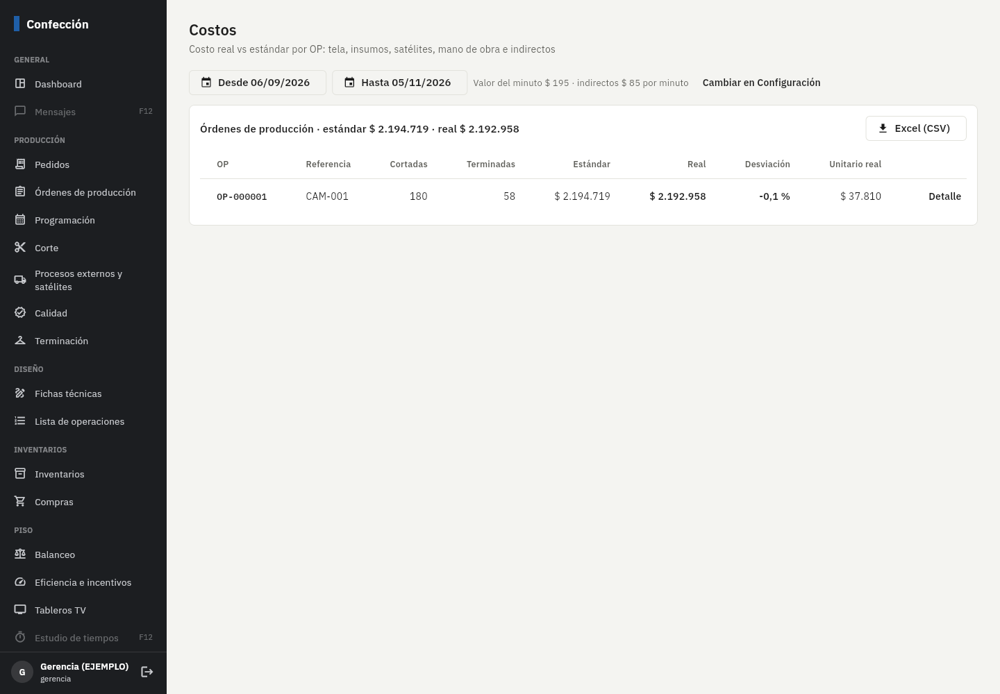
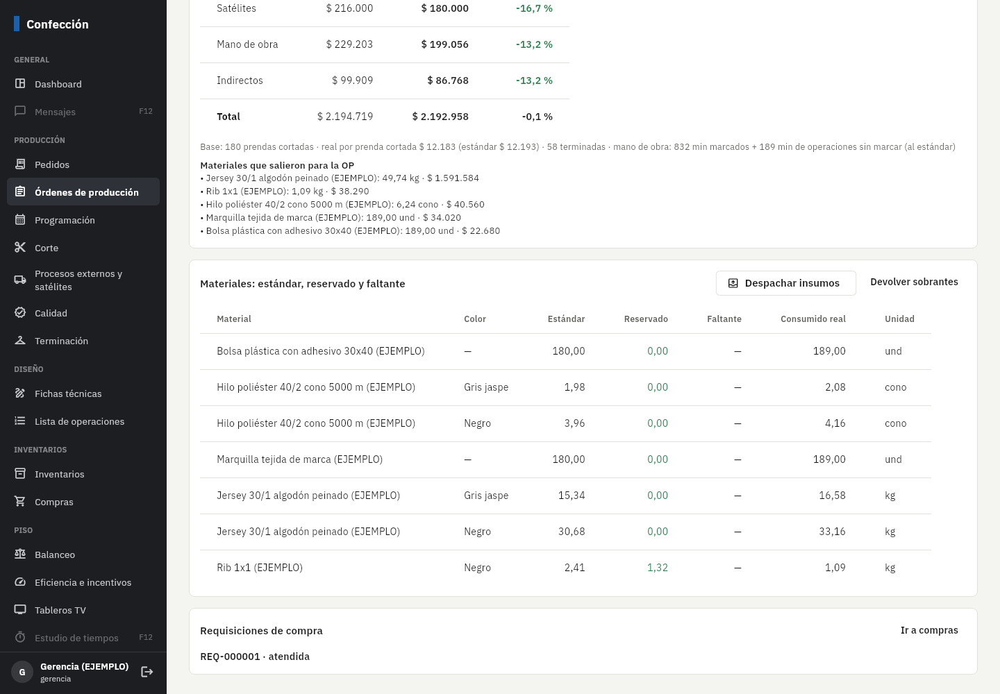
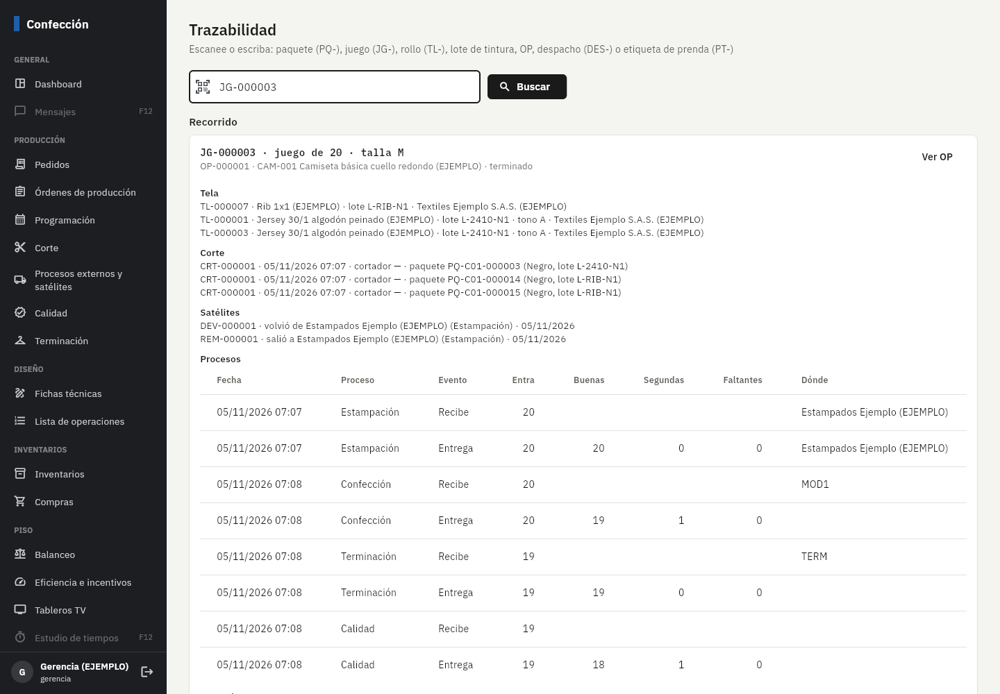
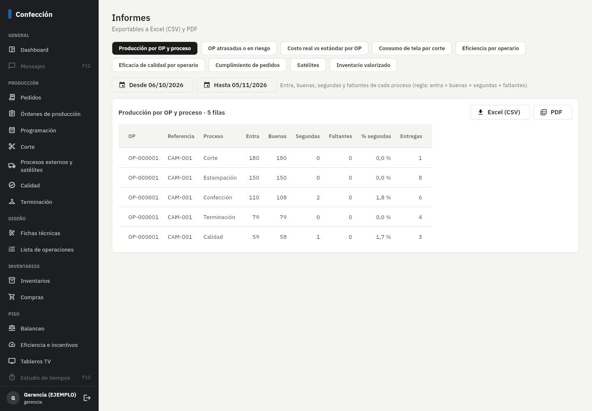

# Fase 10: costos reales, trazabilidad inversa, dashboard e informes

**Estado:** terminada el 5/nov/2026. Falta tu revisión.

## Qué incluye

| Parte | Detalle |
|---|---|
| Dashboard | Página de inicio de Gerencia y Producción: OP activas y atrasadas, prendas en proceso, eficiencia de hoy, terminadas en la semana, aceptación de calidad, prendas por despachar y paros activos (cada cuadro lleva a su detalle). **Kanban por proceso**: cada OP aparece en cada proceso donde tiene prendas (cuántas, en proceso, esperando o en satélite), con su avance terminado, la fecha de entrega en rojo si está atrasada o en ámbar si la programación no alcanza, y avisos de falta de material o devoluciones de calidad. Abajo, las alertas abiertas. |
| Costo real vs estándar | Por OP y por concepto: **tela** (lo que salió de los rollos en el corte, al costo de cada rollo), **insumos** (lo despachado a la OP menos lo devuelto), **satélites** (cuentas por pagar de la OP), **mano de obra** e **indirectos** (minutos reales de las marcaciones × valor del minuto vigente ese día; las operaciones que nadie marca, como corte, van al estándar). El estándar se calcula para las **prendas cortadas** con la ficha. Desviación % por concepto y total, costo por prenda. En *Costos* y dentro del detalle de la OP. **Solo Costos y Gerencia** (el jefe de producción no ve costos, como quedó en la Fase 1). |
| Despacho de insumos a la OP | En el detalle de la OP, Bodega pulsa **Despachar insumos** (hilos, marquillas, bolsas…): sale del inventario con documento **SAL**, libera la reserva de la OP y suma a lo consumido. **Devolver sobrantes** los regresa con motivo. Así el costo real de insumos queda completo. |
| Trazabilidad inversa | *Trazabilidad*: se escanea o escribe un **paquete o juego**, un **rollo**, un **lote de tintura**, una **OP**, un **despacho** o la **etiqueta de una prenda** (reclamo de un cliente). Muestra rollos y lote de tintura, proveedor, corte y cortador, satélites con sus remisiones, cada proceso (quién recibió y entregó, buenas, segundas, faltantes), qué operario hizo cada operación y cuándo, inspecciones de calidad y a dónde fue (producto terminado, segundas, despacho y cliente). Desde un rollo o un lote va **hacia adelante**: qué cortes y qué paquetes salieron de él. Botón *Trazabilidad* en el detalle de la OP. |
| Informes | *Informes*, todos exportables a **Excel (CSV) y PDF**: producción por OP y proceso, OP atrasadas o en riesgo, costo real vs estándar, consumo de tela por corte, eficiencia por operario, eficacia de calidad, cumplimiento de pedidos, satélites (enviadas, devueltas, segundas, a tiempo, valor) e inventario valorizado (telas e insumos al costo promedio; producto terminado al costo estándar). |

**Ejemplo verificado** (OP-000001 de EJEMPLO, 180 camisetas cortadas): estándar $ 2.194.719, real $ 2.192.958 (−0,1 %):
tela +4,7 %, insumos +5,0 % (se despachó 5 % más que el estándar), satélites −16,7 %, mano de obra −13,2 %. Valor del minuto
de EJEMPLO $ 195 e indirectos $ 85.

## Pruebas automáticas (todas pasan)

- **469** pruebas de base de datos (**38** nuevas): despacho de insumos (permisos, sin existencias, la tela no sale por aquí,
  libera la reserva, documento SAL con el costo promedio), devolución (no más de lo que salió, exige motivo); costo de la OP (seis
  conceptos, el total es la suma, insumos = 8 conos × $ 4.500, tela = lo que salió del corte, satélites = cuentas por pagar, mano
  de obra estándar = SAM × prendas × valor del minuto, base = prendas cortadas, desviación), el jefe de producción no ve costos;
  trazabilidad desde juego, rollo (hacia adelante), lote (sin importar mayúsculas), OP, despacho y producto; código inexistente;
  el satélite no consulta; dashboard; los seis informes con sus cuadres (p. ej. entra = buenas + segundas + faltantes;
  inventario valorizado 42 conos × $ 4.500).
- **90** pruebas de la app y **5** de punta a punta con Supabase y PowerSync reales (siguen pasando).

## Cómo probarlo paso a paso

1. Aplique las migraciones (no cambia la sincronización de las tablets).
2. Entre como **Gerencia**: el inicio es el **Dashboard**. Toque una OP del Kanban.
3. En la OP: tarjeta **Costo real vs estándar** y botón **Trazabilidad**.
4. Como **Bodega**, en la misma OP: **Despachar insumos** → revise cantidades → *Despachar*. Vuelva a ver el costo de insumos.
5. *Trazabilidad*: pruebe con un juego (`JG-…`), un rollo (`TL-…`), un lote de tintura, `DES-…` o una etiqueta `PT-…`.
6. *Informes*: elija uno, cambie las fechas, descargue Excel y PDF.
7. *Costos*: lista de OP con su desviación → *Detalle*.

## Capturas (datos de ejemplo)

## Errores encontrados y corregidos al probar

- El Kanban ponía cada OP en un solo proceso aunque tuviera prendas en varios: ahora aparece en cada uno con sus prendas.
- El costo por prenda se dividía entre las terminadas aunque la OP siguiera en proceso (inflaba el valor): mientras no termine,
  es por prenda cortada.
- Si el corte no tenía cortador asignado o la entrega se hizo desde la web, la trazabilidad no decía quién: ahora muestra quién
  lo registró.

## Pendientes y decisiones (dígame si cambia algo)

- **Mano de obra real** = minutos reales de las marcaciones (incluye ineficiencia y reprocesos) × valor del minuto. Si prefieren
  costear con la **nómina real** (lo que se pagó en la quincena repartido por minutos), se puede hacer en la Fase 11 con Alegra
  Nómina.
- Las operaciones que no se marcan en tablet (corte, por ejemplo) se costean al estándar.
- El producto terminado se valoriza al costo estándar de la ficha vigente.
- **Incentivos** (individual y por quincena): el grupo ya viene así por defecto. Falta que me diga los **tramos y valores**
  (p. ej. desde 85 % → $ X, desde 95 % → $ Y) o los configura en *Eficiencia e incentivos → Incentivos*.
