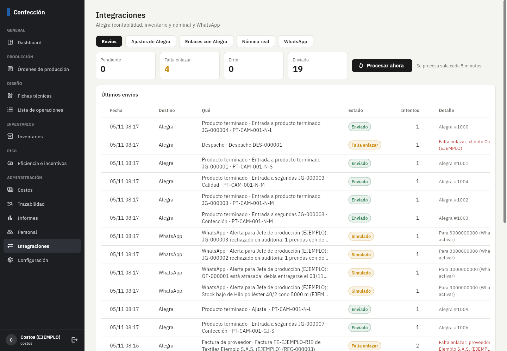
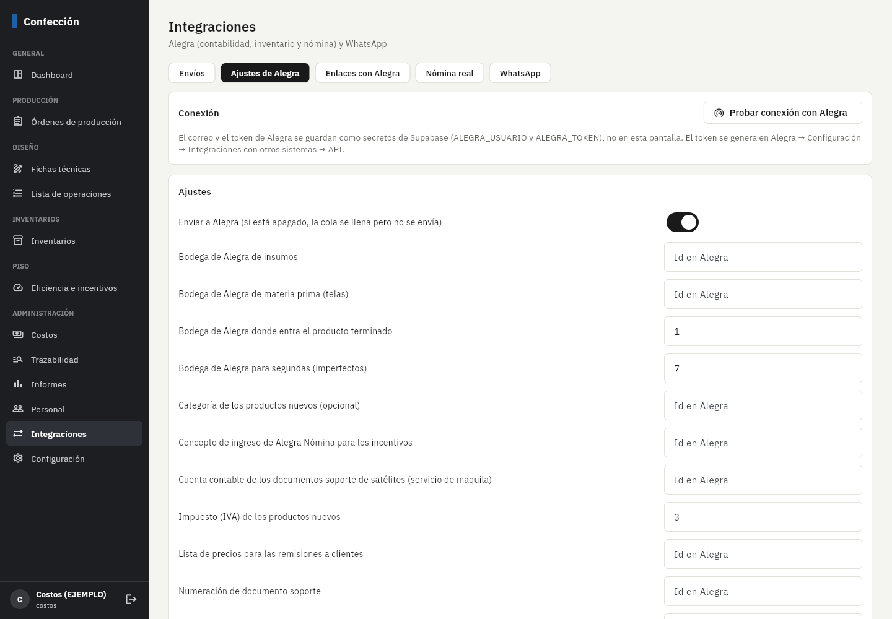
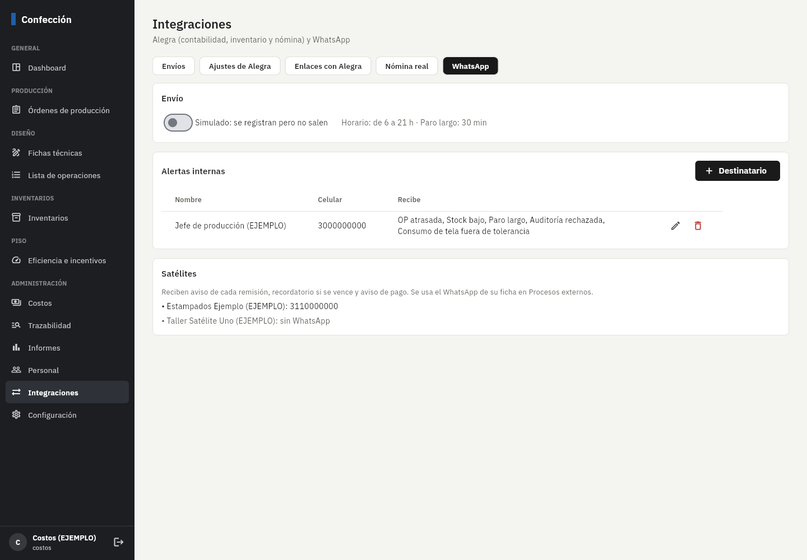

# Fase 11: integraciones con Alegra y WhatsApp

**Estado:** terminada el 5/nov/2026, probada con Alegra y WhatsApp **simulados**. Falta tu revisión y activarla con las claves
reales (pasos abajo). Shopify y portal B2B quedan por fuera, como lo decidiste.

## Qué hace

| Hecho en la app | Qué pasa en Alegra |
|---|---|
| Se aprueba una ficha | Se **crean los productos** (uno por color y talla: `CAMISETA BÁSICA NEGRO / M`) con referencia, precio, IVA y la bodega de producto terminado; quedan enlazados solos. |
| Sale un paquete de calidad (último proceso) | **Ajuste de entrada**: las buenas a la bodega de producto terminado, las segundas a la de imperfectos. Los ajustes y traslados de producto terminado hechos en la app también van. |
| Despacho a un pedido | Si el cliente es una **tienda propia**: **traslado de bodega**. Si es un cliente: **remisión** con su lista de precios. Si se anula el despacho: se anula la remisión o se hace el traslado de vuelta. |
| Bodega confirma una recepción con número de factura | **Factura de proveedor** con las telas a la bodega de materia prima y los insumos a la de insumos. |
| Consumo de materia prima de cada OP (corte y despacho de insumos) | Un **ajuste de salida por OP y día** (se envía el día siguiente). |
| Costos aprueba la cuenta de un satélite | **Documento soporte** a la cuenta contable de maquila. Cuando se paga en Alegra, la cuenta queda **pagada** en la app. |
| Se aprueban los incentivos de la quincena (*Eficiencia → Incentivos → Aprobar y enviar a nómina*) | Se agrega el **incentivo** como concepto en la nómina de cada operario en **Alegra Nómina**. |

| Desde Alegra | Qué pasa en la app |
|---|---|
| Nómina de la quincena (*Integraciones → Nómina real → Importar*) | Se guarda el costo de cada empleado (por cédula) y se calcula el **valor real del minuto** = costo de la nómina de planta / minutos de turno pagados. El **costo de mano de obra de cada OP** usa ese valor en los días de esa quincena. |

**WhatsApp** (simulado hasta que activen la cuenta):
- Al jefe de producción (o a quien elijan): OP atrasada, stock bajo, paro largo (30 min, ajustable), auditoría rechazada,
  consumo de tela fuera de tolerancia, falta de material, inventario negativo.
- A los satélites: aviso de cada remisión (qué lleva y cuándo devolverla), recordatorio si se vence y aviso de pago.
- Horario: de 6 a 21 h (lo que ocurre de noche sale a las 6).

**Cómo funciona por dentro**
- Todo lo que sale va a una **cola**. Cada envío tiene una clave única, así que **nunca se duplica**, aunque se procese dos veces.
- Si Alegra no responde, se **reintenta** con espera creciente (1, 2, 4… minutos hasta 6 horas); tras 8 intentos queda en
  *Error* para revisar.
- Si falta un **enlace** (un cliente, proveedor, material o producto que no está enlazado con Alegra), el envío queda en
  *Falta enlazar* y dice qué falta; al enlazarlo en *Integraciones → Enlaces*, sale solo.
- Las claves de Alegra y WhatsApp viven **solo en los secretos de Supabase**; la app y el navegador nunca las ven.
- Pantalla **Integraciones** (Costos y Gerencia): envíos y su estado, *Procesar ahora*, reintentar o descartar, ver lo enviado
  y lo que respondió Alegra, ajustes, enlaces, nómina real y WhatsApp.

## Pruebas automáticas (todas pasan)

- **512** pruebas de base de datos (**43** nuevas): todo lo de las fases anteriores quedó en la cola; el consumo diario no se duplica; si falta un
  enlace el trabajo dice cuál; dos pasadas no toman el mismo trabajo; éxito, reintento, error tras 8 intentos, reintentar por
  Costos (el jefe de producción no puede); bloqueado → al enlazar vuelve a la cola; nadie cambia la cola desde la web; OP
  atrasada y stock bajo → alerta → WhatsApp sin repetir; recordatorio de remisión vencida; nómina importada (un empleado sin
  enlazar), valor real del minuto = costo / minutos pagados, días con y sin nómina real, el costo de la OP usa la nómina real;
  incentivos aprobados → un concepto por operario, no se aprueba dos veces, Bodega no aprueba, no se borra; pago de satélite;
  permisos.
- **Edge Function** (8 pruebas con Alegra/WhatsApp simulados): formato de cada documento (ajuste, traslado, remisión y cómo se
  anulan, consumo por bodega, documento soporte), teléfono colombiano y plantillas, cola con envío/enlace/bloqueo/reintento,
  Alegra apagado no se toca, WhatsApp simulado, fuera de horario no sale, incentivo agregado a la nómina conservando los
  conceptos que ya tenía.
- **Punta a punta** con la base local real: los productos de la ficha se crean en el Alegra simulado y quedan enlazados; una
  entrada de producto terminado sale como ajuste en la bodega configurada.
- La compilación de GitHub ahora también corre las pruebas de la Edge Function.

## Cómo activarlo (una vez)

1. **Subir a Supabase**: en GitHub → Actions → **Desplegar en Supabase** → Run workflow (antes, en Settings → Secrets,
   agregue `SUPABASE_ACCESS_TOKEN`, `SUPABASE_PROJECT_REF` y `SUPABASE_DB_PASSWORD`; el archivo explica de dónde salen).
2. **Clave de Alegra**: en Alegra → Configuración → *Integraciones con otros sistemas* → API, copie el **token**. En Supabase →
   Edge Functions → **Secrets** agregue `ALEGRA_USUARIO` (el correo con el que entra a Alegra) y `ALEGRA_TOKEN`.
3. **Procesar cada 5 minutos**: agregue también el secreto `INTEGRACIONES_CLAVE` (una palabra larga inventada) y en Supabase →
   SQL Editor ejecute (cambiando lo que está en MAYÚSCULAS):
   ```sql
   select cron.schedule('integraciones', '*/5 * * * *', $$
     select net.http_post(
       url := 'https://SU_PROJECT_REF.supabase.co/functions/v1/integraciones',
       headers := jsonb_build_object('Content-Type', 'application/json', 'Authorization', 'Bearer SU_ANON_KEY',
                                     'x-clave', 'SU_INTEGRACIONES_CLAVE'),
       body := '{"accion": "procesar"}'::jsonb)
   $$);
   ```
   (requiere las extensiones `pg_cron` y `pg_net`: Database → Extensions).
4. En la app, **Integraciones → Ajustes de Alegra**: *Probar conexión*; elija las bodegas (producto terminado = la que usen
   para recibir de planta, segundas = IMPERFECTOS, materia prima, insumos), la lista de precios de las remisiones, el IVA, la
   numeración de documento soporte, la cuenta contable de maquila y el concepto de nómina para los incentivos.
5. **Integraciones → Enlaces**: enlace los clientes (y marque las tiendas propias con su bodega), proveedores, satélites, telas e
   insumos, y los productos que ya existían en Alegra. Los empleados se enlazan solos por la cédula.
6. Revise **Envíos** con *Enviar a Alegra* apagado (se llena la cola sin enviar) y, cuando todo esté enlazado, enciéndalo.
7. **WhatsApp** (cuando tengan la cuenta): en Meta Business cree el número y estas plantillas (categoría *Utilidad*, idioma
   español), luego agregue los secretos `WHATSAPP_TOKEN` y `WHATSAPP_TELEFONO_ID` y encienda *WhatsApp* en la pantalla:

   | Plantilla | Texto |
   |---|---|
   | `alerta_produccion` | Alerta de producción: {{1}} |
   | `remision_enviada` | Hola. Le enviamos la remisión {{1}} con {{2}} prendas para {{3}}. Por favor devuélvala a más tardar el {{4}}. |
   | `remision_vencida` | Recordatorio: la remisión {{1}} debía devolverse el {{2}}. Por favor avísenos cuándo la entrega. |
   | `pago_satelite` | Le informamos que la cuenta {{1}} por ${{2}} quedó pagada. Gracias. |

## Capturas (datos de ejemplo, Alegra y WhatsApp simulados)





## Lo que hay que verificar con la cuenta real (lo hago con ustedes en la primera prueba)

- Probé el formato de cada documento con un Alegra **simulado** que imita sus respuestas, y lo armé igual a los documentos
  que ya tienen en su cuenta (ajustes, traslados, remisiones y documentos soporte). Aun así, la primera vez conviene
  encender *Enviar a Alegra* con pocos envíos y revisarlos en Alegra. Si Alegra rechaza alguno, el mensaje exacto queda en
  *Envíos* y se corrige sin perder nada (el envío sigue en la cola).
- La API de **Alegra Nómina** (incentivos e importar la quincena) usa otra dirección; si cambia, se ajusta con el secreto
  `ALEGRA_NOMINA_URL` sin tocar el código.
- Las plantillas de WhatsApp dependen de que Meta las apruebe; si piden cambiar el texto, se ajusta en un solo archivo.
