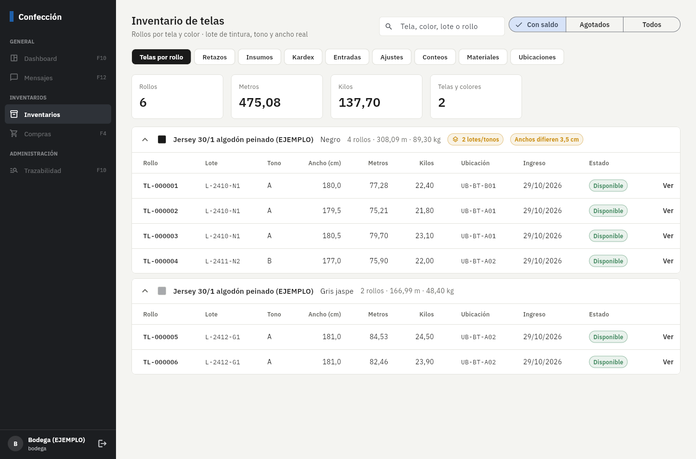
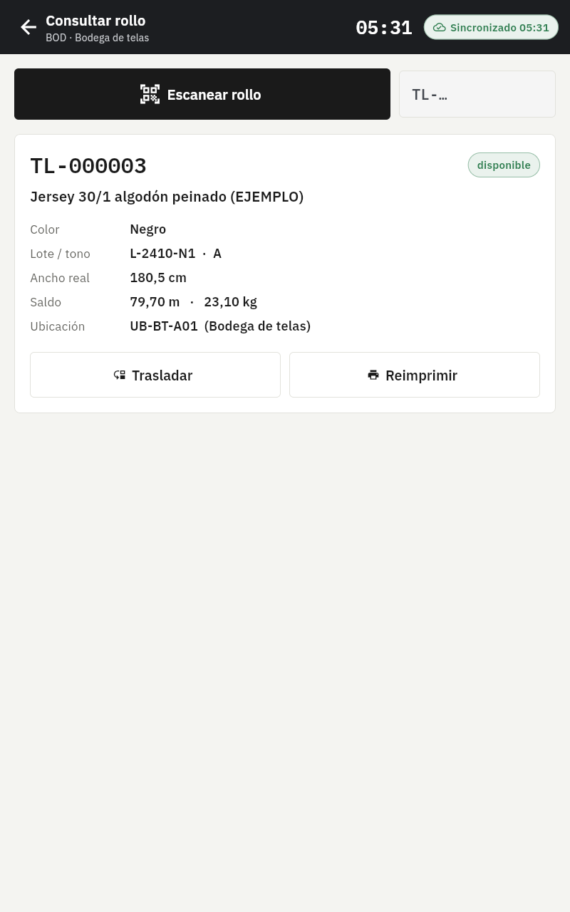
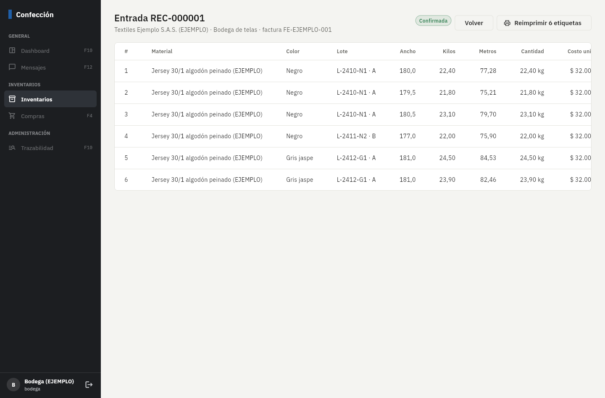

# Fase 2: inventarios y etiquetas Zebra

**Estado:** terminada el 3/nov/2026. Falta tu revisión.

## Qué incluye

| Parte | Detalle |
|---|---|
| Telas por rollo | Cada rollo tiene código `TL-…`, tela, color, lote de tintura, tono, ancho real, metros y kilos (iniciales y saldo), costo, bodega y ubicación. La vista agrupa por tela y color y avisa si hay **varios lotes/tonos** o **anchos que difieren más de 2 cm** (base de la regla 8 en corte). |
| Retazos | "Separar retazo" crea un rollo nuevo con el mismo lote, marcado como retazo y ligado a su rollo de origen. |
| Insumos | Saldos por material, color y bodega: físico, reservado, disponible, stock mínimo y costo promedio. |
| Kardex | Cada movimiento con su saldo acumulado. **No se puede editar ni borrar** (ni siquiera el administrador de la base). |
| Entradas | Rollo por rollo (con botón para repetir el rollo anterior) e insumos. Al confirmar: crea los rollos, suma al inventario y ofrece imprimir todas las etiquetas en orden. Anular una entrada solo se puede si sus rollos no se han movido, y genera movimientos inversos. |
| Ajustes | Toda salida que no va a una OP es un ajuste con motivo, que **aprueba otra persona** (rol con permiso de aprobar: costos o gerencia). Sin aprobar no cambia el inventario. |
| Conteos físicos | Se abren en la web y se cuentan con el celular de bodega **sin conexión** (escanear ubicación y luego rollos; insumos por cantidad). La web muestra las diferencias en vivo. Al cerrar se genera el ajuste por aprobar. |
| Traslados | Escanear rollo → escanear ubicación destino, desde el celular (sin conexión) o desde la web. |
| Saldo negativo | Si por descuentos hechos sin conexión un saldo queda negativo, se aplica igual y se crea una alerta para bodega. |
| Etiquetas Zebra | Plantillas ZPL editables (rollo y ubicación, 100 × 50 mm, ^CI28, QR modelo 2 corrección M de ~29 mm con solo el código). En la tablet: envío por red a la IP fija de la impresora (puerto 9100), **cola local que nunca pierde una etiqueta** y reintenta sola, botón "Imprimir prueba" y reimpresión con motivo. En la web: Zebra Browser Print o PDF al tamaño real. Cada impresión queda registrada. |

## Pruebas automáticas (todas pasan)

- **75** pruebas de base de datos (33 de la Fase 1 + 42 nuevas): saldos = suma del kardex, disponible = físico − reservado,
  salida sin OP ni ajuste rechazada, kardex inmutable, ajuste aprobado solo por otra persona, saldo negativo con alerta,
  traslado sin conexión sin duplicar, retazo, conteo con faltante y rollo en otra ubicación, registro tardío rechazado,
  anulación de entradas, versión de plantillas, reimpresión sin motivo.
- **24** pruebas de la app: lectura de códigos con prefijo, ZPL (tamaño, UTF-8, QR, formato colombiano, datos con `^`),
  envío TCP a una Zebra simulada, cola de impresión con la impresora apagada que imprime en orden al encenderla, PDF de 100 × 50 mm.
- **2** pruebas de punta a punta con Supabase + PowerSync reales: la tablet de entrada y el **celular de bodega sin conexión**
  (traslada y cuenta; al conectar baja rollos, ubicaciones, impresoras y plantillas, y el servidor aplica todo).

## Cómo probarlo paso a paso

1. Aplique las migraciones nuevas y los datos de ejemplo (README §2): `npx supabase db push` y `psql … -f supabase/seed.sql`
   (si ya cargó el seed de la Fase 1, ejecute solo la parte "Fase 2" del archivo).
2. Vuelva a correr `node herramientas/crear_usuarios_demo.mjs`: agrega `costos@ejemplo.co` y `celular-bodega@planta.local`.
3. En PowerSync, pegue de nuevo `sync/sync-rules.yaml` (se agregó el bloque `inventario`) y despliegue.
4. **Web como bodega** (`bodega@ejemplo.co`) → Inventarios:
   - *Telas por rollo*: 6 rollos de jersey; el negro muestra "2 lotes/tonos". Abra un rollo (Ver): kardex, trasladar, separar retazo.
   - *Entradas → Nueva entrada*: bodega de telas, agregue un rollo, use el botón de copiar para un segundo rollo, confirme e imprima.
     Sin Browser Print instalado se abre el PDF de las etiquetas.
   - *Ajustes → Nuevo ajuste*: reste 2 conos de hilo negro. Queda "Por aprobar".
5. **Web como costos** (`costos@ejemplo.co`) → Ajustes → Aprobar. El saldo del hilo baja de 24 a 22.
6. **Conteo**: como bodega, Conteos → Abrir conteo (Bodega de telas, telas). En el celular de bodega: Bodega → Conteo físico →
   escanee `UB-BT-A01` y luego algunos rollos (puede digitar `tl1`, `tl2`…). Ponga el celular en modo avión para algunos:
   quedan pendientes y llegan al volver la señal. En la web el conteo se actualiza solo; ciérrelo y apruebe el ajuste con costos.
7. **Impresora en la tablet**: Configuración → Impresoras y etiquetas → edite la IP de "Zebra bodega (EJEMPLO)" con la IP real
   de su Zebra. En el celular de bodega: Impresora → Imprimir prueba. Si la impresora está apagada, la etiqueta queda en la cola
   con el error y sale sola al encenderla.

## Capturas (vista previa, datos de ejemplo)

| Celular de bodega: consultar rollo | Entrada confirmada |
|---|---|
|  |  |

## Pendientes y decisiones

- **Bluetooth**: la impresión desde la tablet funciona por red (TCP 9100), que es lo recomendado para estaciones fijas.
  Bluetooth necesita un componente nativo adicional que no puedo probar aquí sin una impresora real; propongo hacerlo
  cuando tengan una Zebra Bluetooth para probar.
- **Zebra Browser Print**: la conexión sigue la forma documentada por Zebra (servicio local en el puerto 9100 del PC), pero
  no la pude probar sin el programa instalado. Si no responde, la web imprime en PDF.
- Las etiquetas de **paquete, juego, máquina, producto terminado y carnet** llegan con sus fases (5, 6, 9 y 12). La tabla de
  plantillas ya las admite.
- Los rollos agotados dejan de bajar a las tablets. Por ahora todos los rollos con saldo bajan a todas las tablets; cuando
  haya muchas estaciones se puede limitar por bodega.
- Las capturas de diseño siguen sin llegar.
