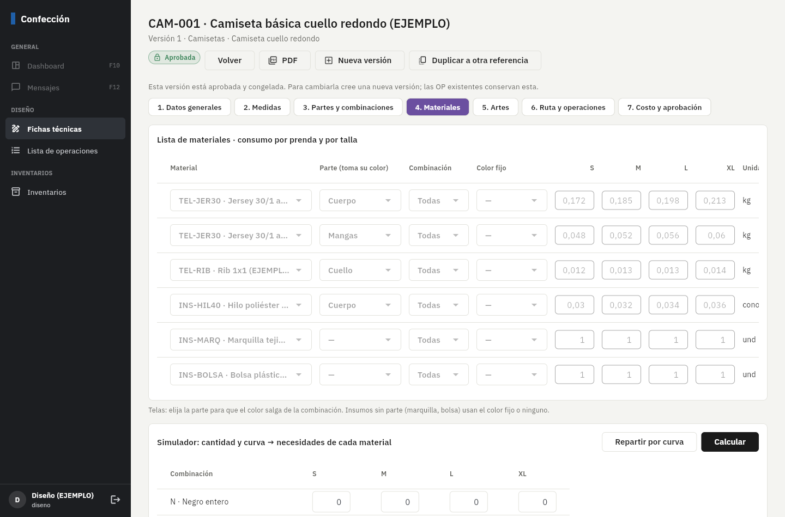
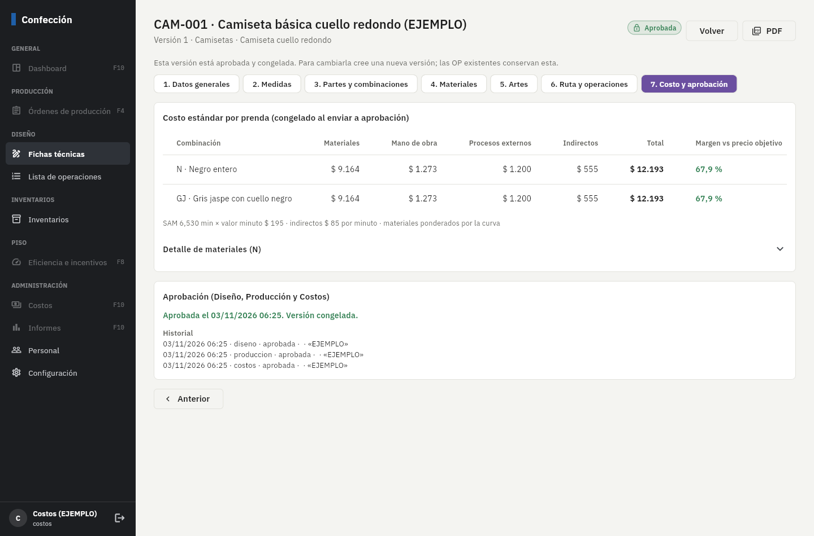
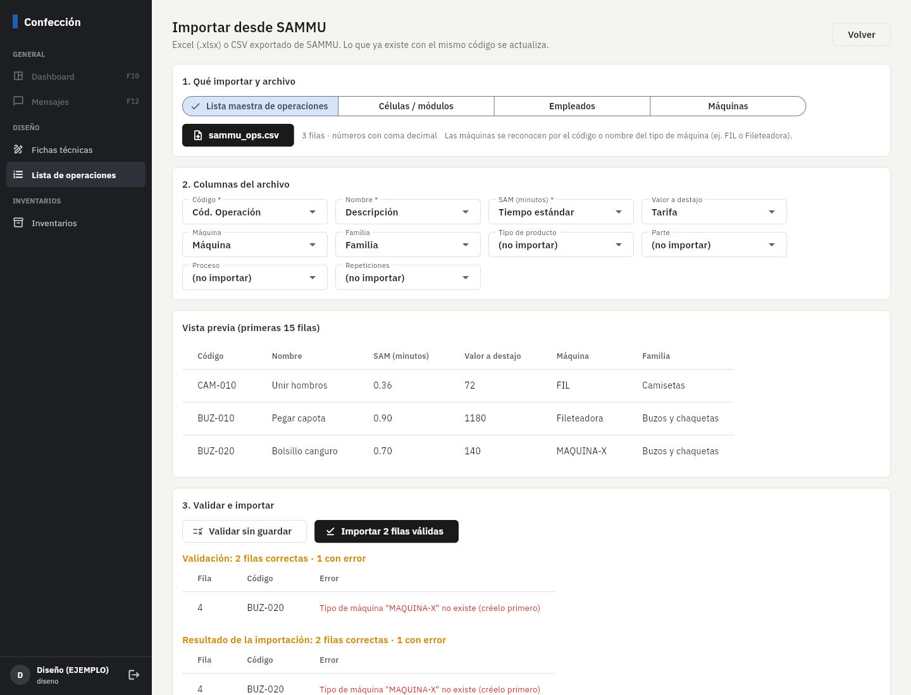

# Fase 3: operaciones, ficha técnica e importador SAMMU

**Estado:** terminada el 3/nov/2026. Falta tu revisión.

## Qué incluye

| Parte | Detalle |
|---|---|
| Lista maestra de operaciones | Código, nombre, familia y tipo de producto, proceso, **SAM**, unidades por hora (60/SAM, calculado), valor a destajo, máquina, parte, repeticiones por unidad, "agrega minutos al SAM", restrictiva y tipo. Cada cambio de SAM o valor queda en el **historial** (quién, cuándo, de dónde: manual, importación o estudio de tiempos). |
| Ficha técnica en 7 pasos | 1 Datos generales (tallas, curva, foto, boceto y molde en Storage) · 2 Medidas por talla con tolerancia · 3 Partes y combinaciones de color por parte · 4 Materiales con consumo por talla, parte, combinación, color fijo, merma y "se puede de retazo", más el **simulador** (cantidad y curva → necesidades contra el stock disponible) · 5 Artes de estampado y bordado · 6 Ruta de procesos (interno o satélite con su costo) y secuencia de operaciones tomada de la lista maestra · 7 Costo estándar y aprobación. |
| Versiones (regla 11) | Solo se edita una versión en **borrador**. En aprobación y aprobada quedan **congeladas** en la base de datos (ni con acceso directo se pueden cambiar). "Nueva versión" copia todo; "Duplicar a otra referencia" crea su versión 1. Al aprobarse, la anterior queda obsoleta y la referencia apunta a la nueva. |
| Costo estándar | Por prenda y por combinación: **materiales** (consumo × costo estándar × merma, ponderado por la curva) + **mano de obra** (SAM × valor minuto) + **procesos externos** + **indirectos** (SAM × indirecto por minuto). Se congela al enviar a aprobación. El valor minuto se configura en *Configuración*. |
| Aprobación | Diseño, Producción y Costos aprueban o rechazan (con motivo) cada uno por su área. Con las tres queda aprobada. Antes de enviar se valida que la ficha esté completa y se copian los SAM vigentes de la lista maestra. |
| PDF | Ficha completa en A4 (datos, foto y boceto, medidas, combinaciones, materiales, artes, ruta, secuencia, costo y aprobaciones). |
| Importador SAMMU | Excel (.xlsx) o CSV (`,` o `;`, UTF-8 o Latin-1). Reconoce las columnas por nombre (sin importar tildes) y deja corregirlas; **valida sin guardar**, muestra los errores por fila y luego importa. Lo que ya existe con el mismo código se actualiza. Tipos: operaciones, células, empleados y máquinas. |

**Ejemplo verificado a mano** (camiseta CAM-001): SAM 6,53 min · materiales $ 9.164 · mano de obra $ 1.273 (6,53 × 195) ·
estampado satélite $ 1.200 · indirectos $ 555 (6,53 × 85) · **total $ 12.193** por prenda. Todos los valores son de EJEMPLO.

## Pruebas automáticas (todas pasan)

- **123** pruebas de base de datos (48 nuevas): costo estándar contra el cálculo a mano, necesidades BOM × cantidades
  con el color correcto por parte, congelamiento de la versión aprobada (partes, consumos, tallas, encabezado, borrado),
  copia completa de versiones sin mezclar ids, una sola versión en borrador, historial de SAM, la ficha aprobada conserva
  su SAM, validación de ficha incompleta, aprobación por área y por rol, rechazo con motivo, versión anterior obsoleta,
  duplicar a otra referencia, importador (validar sin guardar, errores por fila, historial de importación).
- **31** pruebas de la app (7 nuevas): lectura de .xlsx y CSV (coma decimal, Latin-1, BOM), reconocimiento de columnas, PDF de la ficha.
- **2** de punta a punta (sincronización) siguen pasando.

Además, se probó en el navegador contra Supabase real: importar un CSV de SAMMU (2 filas guardadas, 1 con error explicado),
crear una nueva versión desde una ficha aprobada y subir un boceto a Storage.

## Errores encontrados y corregidos al probar

- **Repeticiones no copiadas a la ficha:** el SAM de la camiseta salía 4,83 min en vez de 6,53. Corregido y cubierto por una prueba.
- **"1.250" ambiguo** en los archivos de SAMMU: en CSV de Excel en español es mil doscientos cincuenta; en .xlsx no hay ambigüedad. Se decide según el origen.
- **Supabase rechaza borrados sin condición** (`DELETE requires a WHERE clause`) y eso impedía crear versiones nuevas. Corregido;
  revisé que ninguna otra función tenga el mismo problema.
- Paso 7 fallaba al abrir una ficha ya aprobada, y el menú marcaba "Órdenes de producción" estando en "Operaciones".

## Cómo probarlo paso a paso

1. Aplique las migraciones (`npx supabase db push`), la parte "Fase 3" de `supabase/seed.sql` y vuelva a correr
   `node herramientas/crear_usuarios_demo.mjs` (agrega `diseno@ejemplo.co`).
2. **Configuración** (gerencia o costos): revise el valor minuto e indirectos de EJEMPLO y ponga los reales.
3. **Diseño** (`diseno@ejemplo.co`) → *Lista de operaciones*: edite el SAM de una operación y vea el historial (ícono de reloj).
   Luego *Importar de SAMMU* con `herramientas/plantillas_importacion/operaciones_ejemplo.csv` o con un archivo real de SAMMU.
4. *Fichas técnicas* → CAM-001 v1 (aprobada): recorra los 7 pasos; nada se puede editar. Toque **Nueva versión**: v2 en borrador,
   editable. En *Materiales* use el simulador: "Repartir por curva" con 600 prendas y "Calcular" → necesidades y faltantes.
5. En v2 paso 7: **Enviar a aprobación**. Apruebe con `diseno@`, `jefe.produccion@` y `costos@` (cada uno su área).
   Al tercer visto bueno v2 queda aprobada y v1 obsoleta. Pruebe también rechazar con motivo: vuelve a borrador.
6. **PDF** desde cualquier versión.

## Capturas (datos de ejemplo)

## Pendientes y decisiones

- **Necesito un archivo real exportado de SAMMU** (aunque sea con pocas filas) para confirmar nombres de columnas y formatos.
  El importador ya deja elegir columnas a mano, así que no debería bloquear.
- **OP activas desde SAMMU** se importan en la Fase 4, cuando existan las órdenes de producción.
- La **gerencia** puede aprobar por cualquiera de las tres áreas (útil si falta alguien). Si prefiere que sean siempre tres personas distintas, lo restrinjo.
- El **costo de materiales** usa el costo estándar de cada material. Si un material no tiene costo, aparece en rojo en el detalle
  y su costo cuenta como cero.
- Los archivos (foto, boceto, molde, artes) se guardan en Supabase Storage privado; una versión nueva reutiliza los mismos archivos hasta que se reemplacen.
