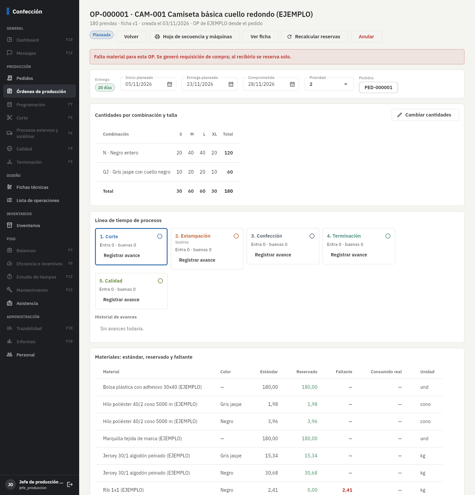
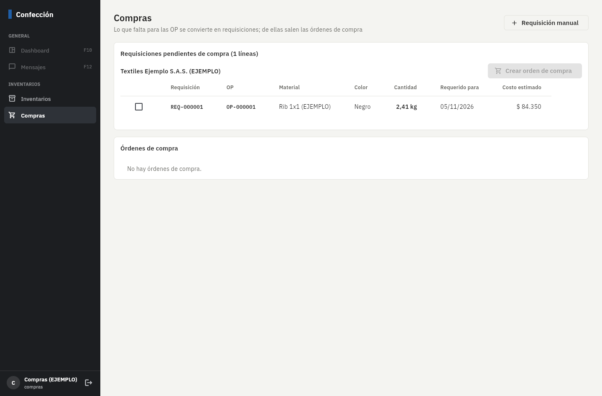

# Fase 4: pedidos, órdenes de producción, reservas y compras

**Estado:** terminada el 3/nov/2026. Falta tu revisión.

## Qué incluye

| Parte | Detalle |
|---|---|
| Pedidos | Cliente, canal, fecha comprometida y líneas por referencia × combinación de color × talla (matriz). Muestra lo pedido, lo que ya está en OP y lo pendiente. Desde el pedido se crea la OP con lo pendiente. |
| Órdenes de producción | Consecutivo `OP-…`, referencia con **su versión de ficha aprobada** (regla 11), matriz de cantidades, fechas planeadas y comprometida, prioridad (1 urgente – 5), proceso actual, días restantes con semáforo y alerta de material. Solo se crean de referencias con ficha aprobada. |
| Reserva automática | Al crear la OP: necesidades = Σ (consumo de la ficha × cantidad por talla, con merma) por material y color; se **reserva** lo disponible (disponible = físico − reservado, regla 4) en las bodegas de telas e insumos; **nunca deja disponible negativo**. Al cambiar cantidades se reserva lo que falte y se libera lo que sobre. Al anular se libera todo y pasa a las OP que esperaban material. |
| Faltantes | Lo que no alcanza queda como **faltante**, la OP con alerta, y se genera una **requisición de compra automática** (sin duplicar lo que ya va en una orden de compra). |
| Compras | Requisiciones pendientes agrupadas por proveedor → **orden de compra** (precio estándar editable, enviar, anular). La **entrada de inventario desde la OC** trae proveedor, materiales y cantidades; al confirmarla suma lo recibido a la OC y **reserva automáticamente para las OP que esperaban ese material**, por prioridad y fecha de entrega. |
| Avance de procesos (regla 5) | Línea de tiempo con los procesos de la ruta. Cada avance registra **entra = buenas + segundas + faltantes** (si no cuadra, no se guarda). A un proceso solo entra lo que salió bueno del anterior. Los avances parciales se acumulan; al terminar el último proceso la OP queda terminada. Desde la Fase 6 esto lo harán las tablets por paquete. |
| Hojas | **Hoja de secuencia** (operaciones, SAM, und/h, minutos y horas para la OP) y **hoja de máquinas** (minutos por tipo de máquina y % de la carga) en PDF. |
| Protecciones | Estado, ficha, cantidades y proceso de la OP solo cambian por sus funciones; fechas, prioridad y observación se editan libremente. Los eventos de proceso no se borran. |

**Ejemplo verificado a mano:** la OP de 180 camisetas (120 negras, 60 gris) necesita 30,68 kg de jersey negro
= (0,22×20 + 0,237×40 + 0,254×40 + 0,273×20) × 1,04. El rib no tiene existencias: faltan 2,41 kg y se generó la requisición.

## Pruebas automáticas (todas pasan)

- **182** pruebas de base de datos (**41** nuevas): validaciones al crear OP, necesidades contra el cálculo a mano, reservas que
  cuadran con el kardex, dos OP compitiendo por el mismo rollo sin disponible negativo, cambio de cantidades que libera,
  pedidos (no se asigna más de lo pendiente, no se borra una línea en OP, al anular vuelve a pendiente), protecciones,
  avance con cantidades (no cuadra, entra más de lo disponible, parciales, terminar), requisición → OC → recepción que
  reserva para la OP correcta, sin duplicar lo que ya está en una OC.
- **36** pruebas de la app (incluye el PDF de hojas).

En el navegador contra Supabase real: compras creó la OC desde la requisición, la marcó enviada y bodega abrió la entrada
precargada desde la OC.

## Errores encontrados y corregidos al probar

- Un alias en `anular_op` chocaba con una variable de la función (la anulación fallaba).
- La matriz de la OP repetía cada combinación una vez por talla (mostraba 720 en vez de 180).
- Las pruebas anteriores asumían una sola fila de saldo por material; con las reservas ahora se suman por bodega.

## Cómo probarlo paso a paso

1. Aplique las migraciones, la parte "Fase 4" de `supabase/seed.sql` y vuelva a correr `crear_usuarios_demo.mjs`
   (agrega `compras@ejemplo.co` y `comercial@ejemplo.co`).
2. **Comercial o jefe de producción** → *Pedidos* → PED-000001: pedido de 180 camisetas ya convertido en OP-000001.
   Cree un pedido nuevo, agregue la referencia CAM-001 con cantidades y pulse **Crear OP**.
3. *Órdenes de producción* → abra la OP: alerta de material (falta rib), materiales estándar/reservado/faltante,
   **Hoja de secuencia y máquinas**. Pruebe **Cambiar cantidades** y vea cómo cambian las reservas.
4. **Compras** (`compras@ejemplo.co`) → *Compras*: marque la línea del rib → **Crear orden de compra** → **Marcar como enviada**.
5. **Bodega** → abra la OC → **Registrar entrada**: elija bodega, complete lote, ancho, kilos y ubicación del rollo y confirme.
   Vuelva a la OP: el rib queda reservado y desaparece la alerta (si no faltan otros materiales).
6. En la OP, **Registrar avance** en Corte: pruebe poner cantidades que no cuadran (no deja) y luego 180 = 178 + 2 + 0.

## Capturas (datos de ejemplo)

## Pendientes y decisiones

- **OP activas desde SAMMU:** falta el archivo de ejemplo. Con un reporte de OP abiertas de SAMMU (OP, referencia,
  color, talla, cantidad, fecha, proceso actual) lo agrego al importador.
- La **fecha posible de entrega** según capacidad llega con la programación de planta (Fase 7).
- El **consumo real** de material se llena con el corte (Fase 5) y los despachos.
- Las OP se reservan por bodega (telas / insumos); el rollo exacto se asigna al cortar (Fase 5), donde se aplica la regla de lotes.
