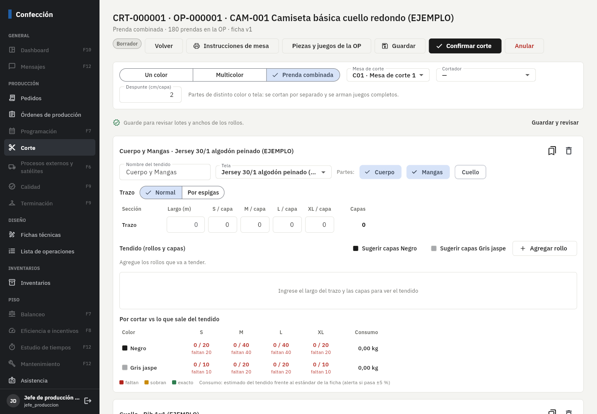
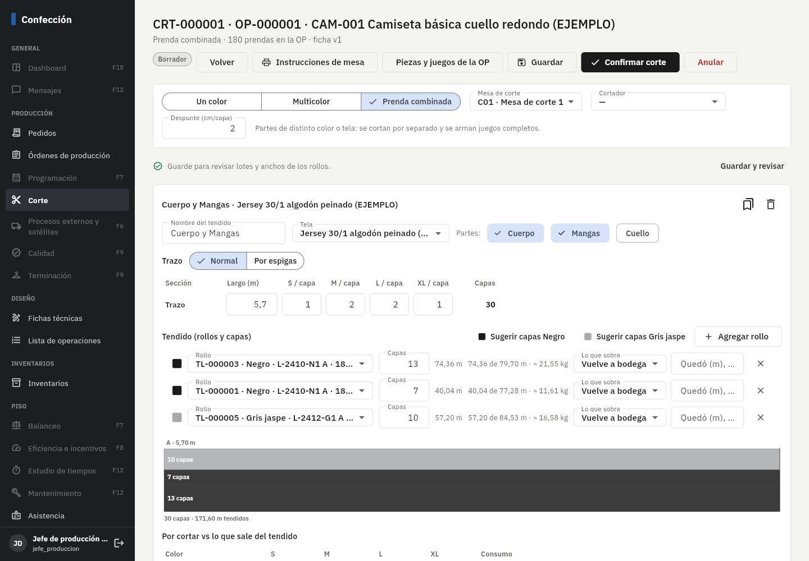
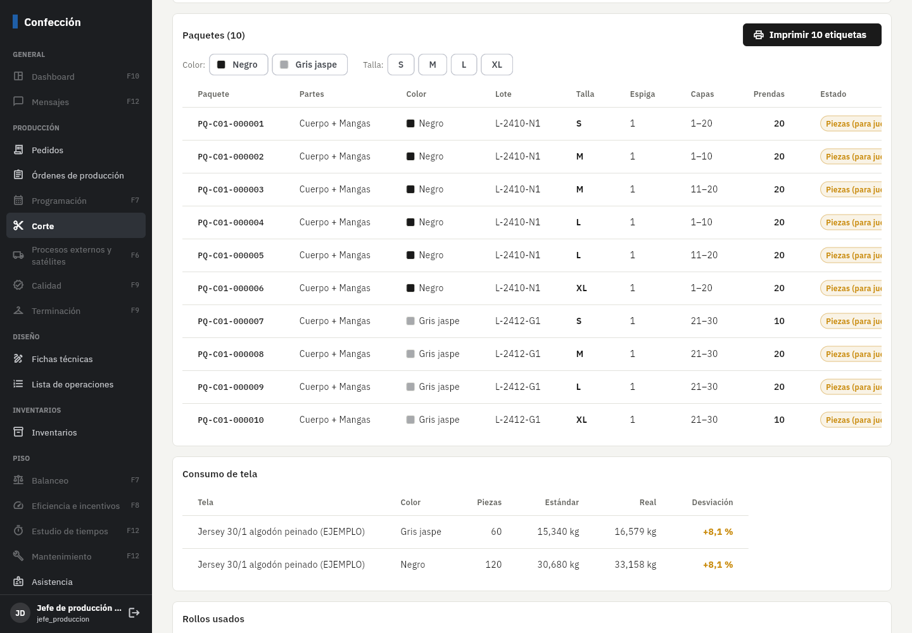
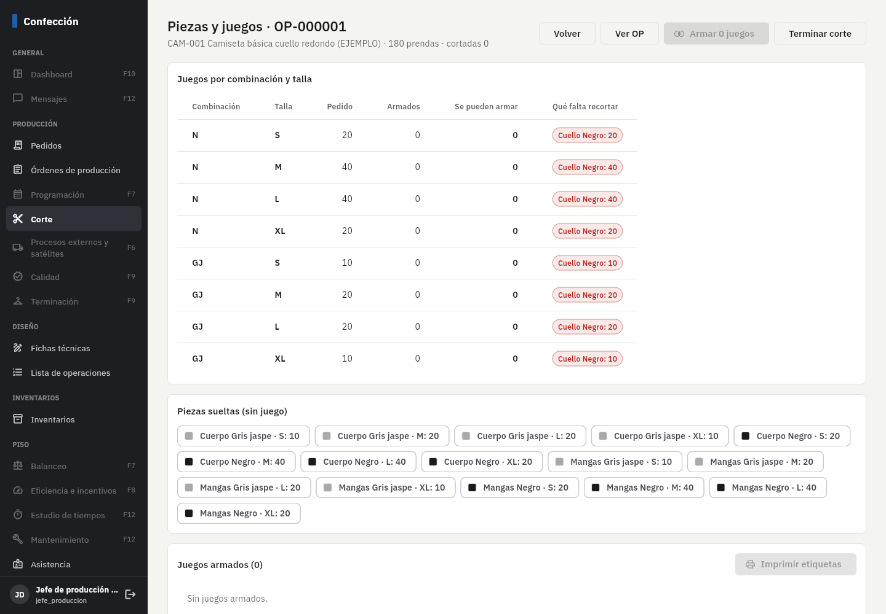
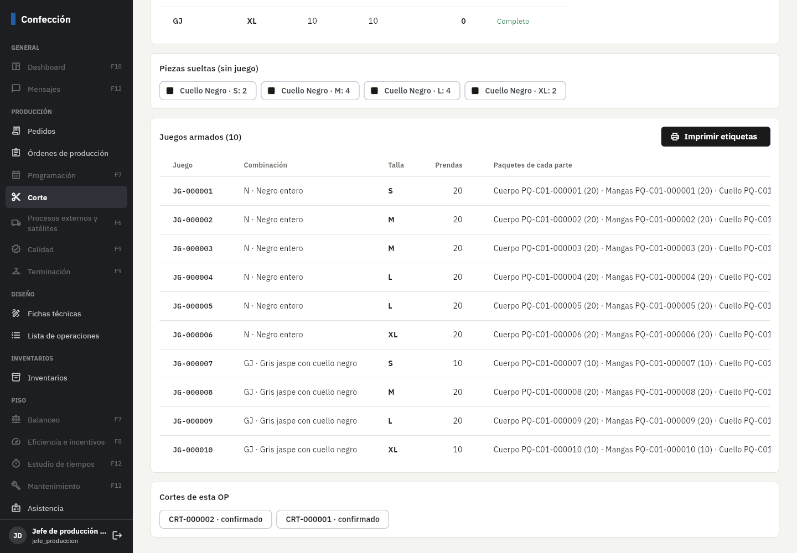

# Fase 5: corte

**Estado:** terminada el 3/nov/2026. Falta tu revisión.

## Qué incluye

| Parte | Detalle |
|---|---|
| Tipos de corte | **Un color** (cada tendido lleva un solo color), **multicolor** (capas de varios colores en el mismo tendido) y **prenda combinada** (partes de distinta tela o color se cortan por separado y se arman juegos). |
| Tendidos | Un corte tiene uno o varios tendidos. Cada uno: tela, partes que corta (p. ej. *Cuerpo + Mangas* en jersey y *Cuello* en rib), trazo y rollos. Al abrir un corte nuevo se arman solos desde la ficha de la OP: un tendido por tela con sus partes. |
| Trazo normal y por espigas | Normal: largo y piezas por talla en cada capa. **Espigas:** de 2 a 5 secciones (A es la cabecera); la espiga 1 cubre todo el largo, la 2 todo menos la última sección… Cada sección muestra cuántas capas le quedan. Botón **Ordenar por demanda** (la cabecera es la que más capas necesita). |
| Cálculo en vivo | metros por capa = largo de las secciones de su espiga + despunte; piezas = capas × piezas por capa; kilos con la proporción kilos/metros de cada rollo. Vista lateral del tendido con los colores. |
| Sugerir capas | Por color, con lo que falta cortar de la OP: capas (normal) o capas por espiga, y las **reparte entre los rollos** de ese color sin pasar su saldo, primero los del mismo lote. |
| Pedido vs cortado | Por color y talla: cortado / pendiente, en rojo lo que falta, ámbar lo que sobra. Consumo estimado contra el estándar de la ficha con alerta si pasa ±5 % (parámetro). |
| Regla 8 (lotes y anchos) | En una OP, un mismo material y color debe venir de un solo lote de tintura y tono, y los anchos no pueden diferir más de 2 cm (parámetro). Se revisa contra los cortes ya confirmados de la OP. Si no se cumple, **no se confirma** hasta que el jefe de corte (permiso *aprobar* en Corte) autorice con un motivo, que queda registrado con su nombre. |
| Confirmar (todo o nada) | El servidor recalcula todo (es la fuente oficial), descuenta cada rollo en el kardex con la OP (regla 1), **libera esa reserva**, registra el consumo real en la OP, y lo que sobra del rollo **vuelve a bodega**, **pasa a retazo** (rollo nuevo con el mismo lote) o **se agota**. Se puede escribir cuánto quedó medido en el rollo. Alerta de desviación si el consumo real se aleja del estándar. |
| Paquetes (regla 9) | Un solo color, lote y talla; máximo 20 prendas (parámetro); por rangos de capas. Código por mesa: `PQ-C01-000001`. Etiquetas 50 × 30 mm (ZPL por Browser Print o PDF), filtrando por color y talla. |
| Juegos (regla 10) | Por combinación y talla se toma de cada parte el color de esa combinación (gris jaspe **con cuello negro**). Primero lo pedido y luego lo que sobre. Un juego no mezcla lotes de la parte principal. Muestra **qué falta recortar** por parte y las **piezas sueltas**. Etiqueta de juego `JG-…` con sus paquetes. El avance de corte de la OP se registra con las prendas en juegos (o en paquetes completos si el tendido trae todas las partes). |
| Anular (regla 2) | Un borrador se anula; un corte confirmado solo lo anula el jefe de corte y solo si sus piezas no están en juegos: se hacen **movimientos inversos** (la tela vuelve a cada rollo, el retazo se cierra, la reserva vuelve), los paquetes quedan anulados y el avance se reversa con un evento inverso. Nada se borra. |
| Terminar corte | Cierra el corte de la OP; pasa al siguiente proceso (en el ejemplo, estampación). |
| Trazos guardados | Cada trazo se puede guardar para la referencia y reutilizar (tallas por código: sirve para versiones nuevas de la ficha). |
| Instrucciones de mesa | PDF A4 con el trazo, el orden de tendido (rollo, color, lote, ancho, capas desde–hasta, metros) y qué hacer con lo que sobra. |

**Ejemplo verificado a mano (pruebas):** jersey negro 6 capas del TL-000001 + 4 del TL-000004 con trazo de 5,70 m y despunte de 2 cm:
6 × 5,72 = 34,32 m = 9,948 kg (22,4 kg / 77,28 m del rollo); total 16,580 kg contra 16,588 kg del estándar (−0,05 %, sin alerta).
Como son de lotes distintos (N1 y N2) y anchos de 180 y 177 cm, no confirma sin autorización.

## Cálculo igual en la app y en el servidor

El motor está en Dart (`app/lib/core/calculos/corte.dart`) para mostrar en vivo, y en SQL (`corte_calcular_bloque`,
`corte_plan_paquetes`) como fuente oficial. Los dos se prueban con los **mismos casos** de `test_vectores/corte/*.json`
(tendido normal con dos lotes y dos colores, espigas de 3 secciones con tramos en desorden, multicolor con redondeo).

## Pruebas automáticas (todas pasan)

- **250** pruebas de base de datos (**68** nuevas): los casos compartidos, permisos (bodega no corta, el cortador no autoriza ni anula
  confirmados), tela equivocada para una parte, rollo que no alcanza, rollo de otro color, corte "de un color" con dos colores,
  regla de lotes y anchos con autorización, paquetes sin mezclar lotes y con su rango de capas, kardex y reservas,
  retazo con el mismo lote, desviación, juegos completos con los colores de cada combinación, sobrantes, anulación con
  movimientos inversos, corte confirmado no editable, terminar corte.
- **55** pruebas de la app (motor de corte, reparto de capas, etiquetas de paquete y juego en ZPL y PDF, instrucciones de mesa).

En el navegador contra Supabase local: el jefe de producción creó el corte de OP-000001, cargó el trazo guardado, pidió
capas sugeridas (20 capas de negro repartidas en TL-000003 y TL-000001 del mismo lote, 10 de gris), guardó y confirmó:
10 paquetes. La pantalla de juegos mostró que faltaba el cuello negro; después de recibir el rib y cortar los cuellos,
**Armar juegos** dejó 180 prendas en 10 juegos y 12 cuellos sueltos.

## Errores encontrados y corregidos al probar

- La lista de OP por cortar no dejaba ver el botón *Nuevo corte* (tabla muy ancha).
- Un tendido vacío impedía confirmar el corte (p. ej. sin rib todavía): ahora se ignora y el cuello se corta después.
- El menú de trazos mostraba trazos de otra tela; las tallas de la sugerencia salían en desorden.

## Cómo probarlo paso a paso

1. Aplique las migraciones (`npx supabase db push`) y la parte "Fase 5" de `supabase/seed.sql` (trazos de ejemplo).
2. **Jefe de producción** → *Corte* → OP-000001 → **Nuevo corte**. Vea los dos tendidos creados desde la ficha
   (*Cuerpo y Mangas* en jersey, *Cuello* en rib).
3. En el jersey: icono de marcador → *Usar: Cuerpo y mangas 1-2-2-1*. Pulse **Sugerir capas Negro** → *Aplicar*, luego gris.
   Vea la vista lateral, el pedido vs cortado y el consumo contra el estándar.
4. Pruebe **Por espigas** con 3 secciones, o el trazo *por espigas (EJEMPLO)*, y **Ordenar por demanda**.
5. Ponga a mano un rollo negro del lote L-2411-N2 → **Guardar**: aparece la regla de lotes y el botón **Autorizar**.
6. **Instrucciones de mesa** (PDF) → **Confirmar corte**. Vea paquetes, consumo y rollos; **Imprimir etiquetas**
   (sin Zebra Browser Print abre el PDF de 50 × 30 mm). En *Inventarios → Kardex* aparecen las salidas con la OP.
7. **Piezas y juegos de la OP**: sin rib dice qué falta recortar. Reciba rib (Fase 4: compras → entrada), haga otro corte
   solo con el tendido de cuello, confirme y pulse **Armar juegos** → imprima las etiquetas de juego → **Terminar corte**.

## Capturas (datos de ejemplo)

## Pendientes y decisiones

- **Tablet de la mesa de corte sin conexión:** en esta fase el corte se registra desde el panel web (o un PC/tablet con
  navegador junto a la mesa, con internet). La versión sin conexión en la app de planta va en la **Fase 6**, junto con el
  recorrido de paquetes por los procesos; el servidor ya numera los paquetes por mesa para eso.
- Los **diseños de pantalla** que mencionaste no han llegado; si tienes los de corte, los ajusto.
- Por defecto el rol *Corte* tiene permiso de aprobar (autorizar lotes y anular). Si los cortadores usan ese rol, quítele
  *aprobar* en *Configuración → Permisos* y déjelo solo al jefe de corte.
- Los consumos de la ficha de ejemplo y los largos de trazo son ficticios: la desviación real se verá con datos de planta.

## Cambios después de la revisión

- **Sin destajo:** la planta no paga a destajo. Se quitó el valor a destajo de la lista de operaciones, de la ficha (paso 6),
  de su PDF y del importador (la columna *Precio/Tarifa* de SAMMU se ignora). La columna queda en la base sin uso y en
  cero. En la Fase 8 se liquidan solo los incentivos por eficiencia, si aplican.
- **OP activas de SAMMU:** propuesta de plantilla en `herramientas/plantillas_importacion/op_activas_ejemplo.csv`.

