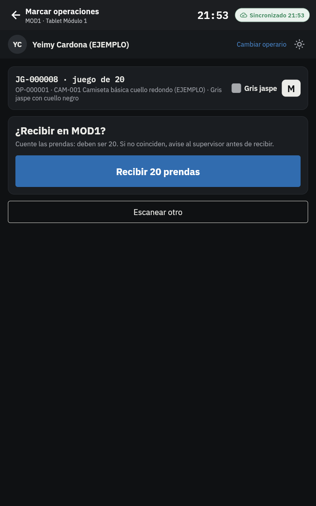
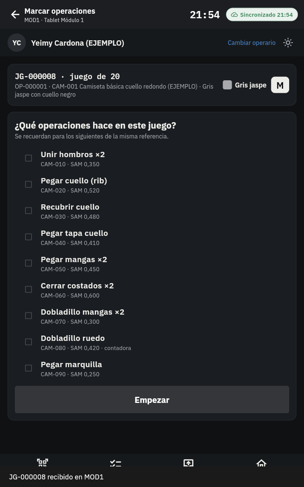
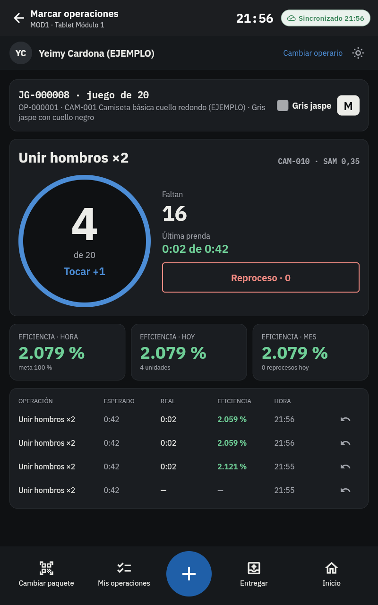
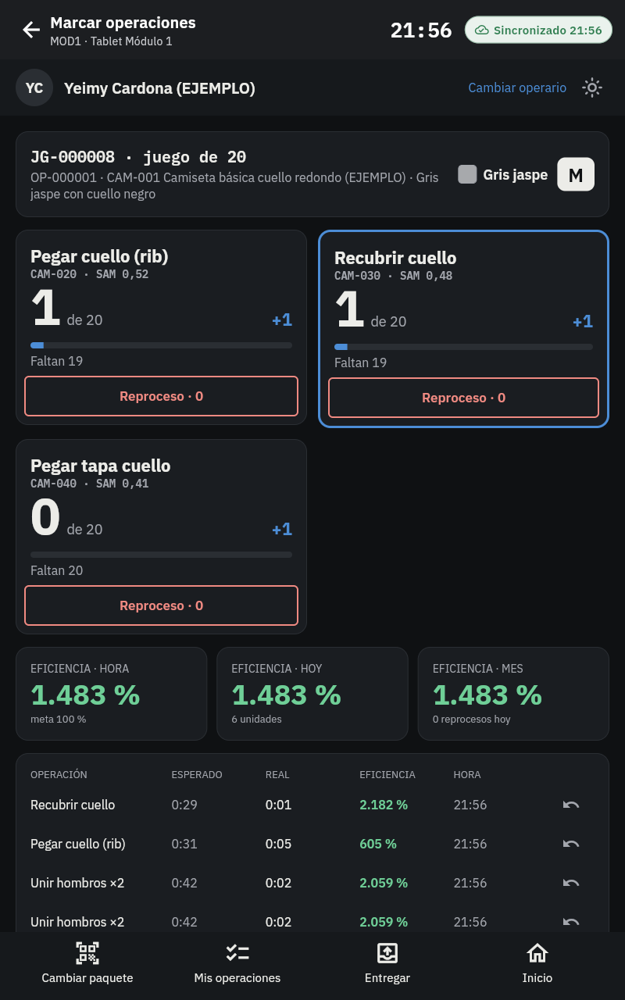
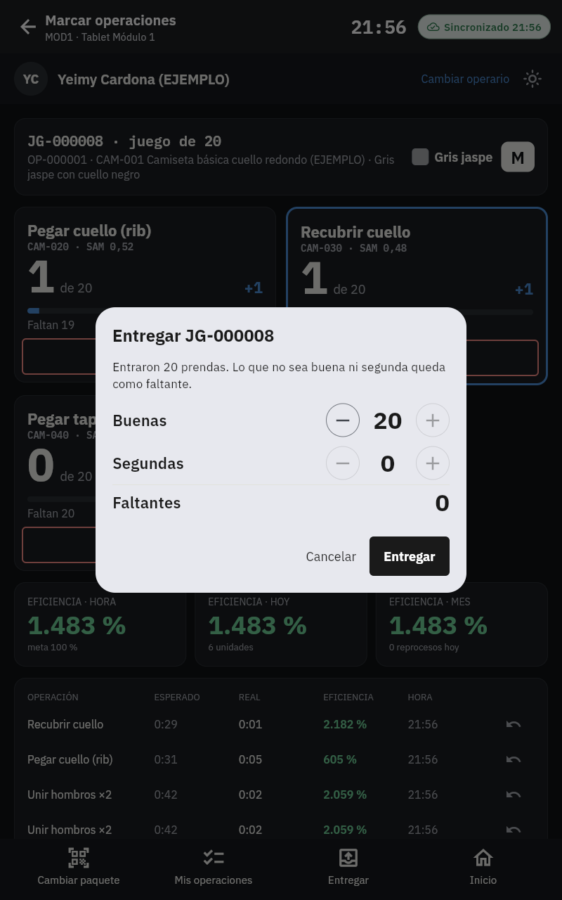
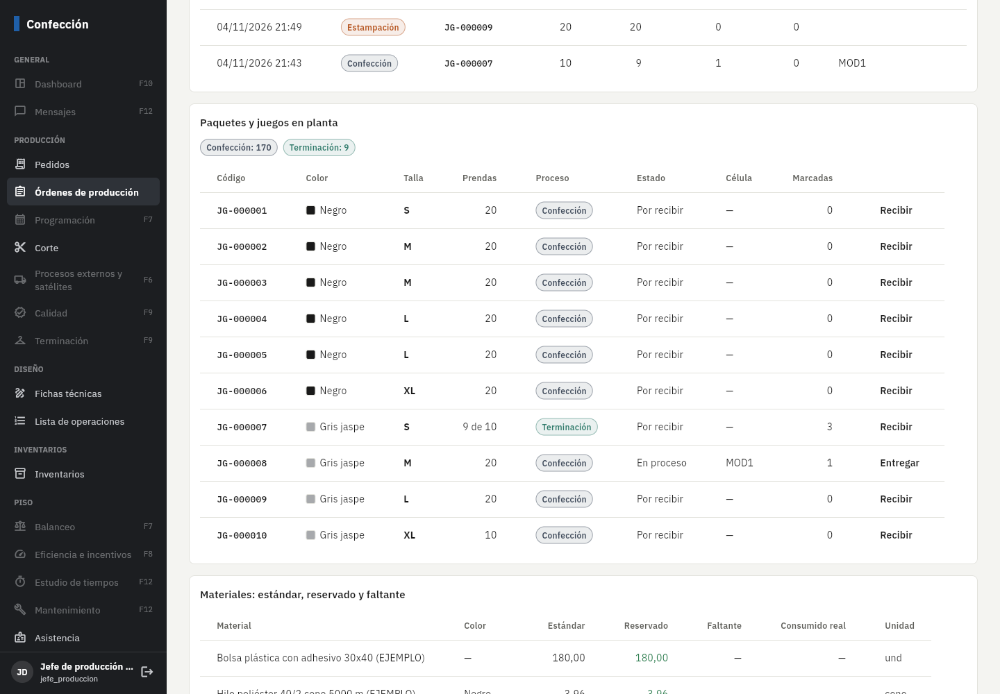

# Fase 6: tablet del módulo y recorrido de paquetes y juegos

**Estado:** primera parte terminada el 5/nov/2026 (tablet del módulo y recorrido). Falta tu revisión.
Las remisiones a satélites quedan para la segunda parte (ver *Pendientes*).

## Qué incluye

| Parte | Detalle |
|---|---|
| Recorrido por procesos | Lo que se escanea en planta es la **unidad de trabajo**: un juego (prenda combinada) o un paquete que trae todas las partes. Al salir de corte queda esperando el proceso que sigue en la ruta de la OP. En cada proceso se **recibe** y se **entrega** con buenas, segundas y faltantes (regla 5); las buenas siguen al proceso siguiente. Cuando pasan todas las unidades, el proceso queda terminado solo y la OP avanza. |
| Tablet del módulo | Diseño aprobado (maqueta). El operario escanea su carnet, luego el juego o paquete; si no está recibido, lo recibe contando las prendas. Elige sus operaciones de la ficha (se recuerdan para la misma referencia). **Una operación:** contador grande que suma con cada toque, faltantes, tiempo de la última prenda y **reproceso**. **Varias:** tarjetas de a 2 por fila, cada una con su contador y su botón de reproceso. Eficiencia de la hora, del día y del mes; últimas marcaciones con **anular**. **Entregar:** buenas (sugeridas por la operación contadora), segundas y faltantes. |
| Sin conexión | Todo (recepción, marcaciones, anulaciones, entrega) se guarda en la tablet y sube solo, sin duplicar. Si sin conexión se marcó más de lo que trae la unidad, el servidor lo acepta y crea una alerta. |
| Eficiencia | Minutos esperados = SAM × repeticiones × unidades (reproceso: SAM de reproceso). Minutos reales = desde la marcación anterior del operario el mismo día; si pasaron más de 30 min (parámetro) no se mide. La tablet calcula al instante y el **servidor recalcula la oficial** con la misma regla. Resumen diario por operario (baja a la tablet para la eficiencia del mes). |
| Fondo oscuro o claro | El oscuro es el predeterminado; el botón del sol en la tablet cambia a claro (se guarda por tablet). |
| Otras estaciones | Las tablets de terminación, calidad, etc. usan la misma pantalla solo para recibir y entregar. |
| Oficina | En la OP: **Paquetes y juegos en planta** (proceso, estado, célula, marcadas) con *Recibir* y *Entregar* para los procesos sin tablet (p. ej. estampación en satélite). El historial muestra cada entrega con su juego o paquete. Con unidades, el avance después de corte ya no se registra a mano. |
| Compilación automática | Cada vez que se sube código a GitHub se corren las pruebas y se generan el **APK** y el **panel web** para descargar (no hace falta VS Code). |

## Pruebas automáticas (todas pasan)

- **282** pruebas de base de datos (**32** nuevas): el módulo no recibe lo que va para otro proceso, permisos, entrega que no cuadra,
  estampación desde la web que se cierra sola, recepción idempotente (reenvío) y doble recepción rechazada, eficiencia oficial
  (primera sin tiempo, 1 minuto real), operación de otra ficha, hora en el futuro, marcación de más con alerta, anulación,
  reproceso, entrega con segunda que pasa a terminación.
- **62** pruebas de la app: cálculo de eficiencia igual al servidor y la tablet sobre la base local real (recibir, marcar,
  anular, entregar, eficiencia del mes).
- **Punta a punta** con Supabase y PowerSync reales: la tablet del módulo descarga los juegos, recibe, marca 3 veces **sin
  conexión**, entrega; al volver la señal sube todo una vez, el servidor calcula los minutos reales y baja la eficiencia del día.
- En GitHub: la compilación automática terminó bien (pruebas, APK y panel web).

## Errores encontrados y corregidos al probar

- PowerSync no acepta listas `IN ('a','b')` en las reglas de descarga: se cambiaron por condiciones simples.
- La eficiencia de la tablet y la del servidor diferían en centésimas por el redondeo de los minutos: ahora usan el mismo.
- El historial de la OP no cargaba (dos relaciones entre eventos y juegos): se indicó cuál usar.

## Cómo probarlo paso a paso

1. Aplique las migraciones y la sincronización nueva (`sync/sync-rules.yaml` en PowerSync).
2. Para tener juegos listos en confección con los datos de ejemplo:
   `psql "SU_CADENA" -f herramientas/preparar_planta_ejemplo.sql` (corta, arma juegos y los pasa por estampación).
3. En la tablet del módulo 1 (`tablet-mod1@planta.local`) → **Marcar operaciones** → carnet de un operario (o escriba E003).
4. Escanee o escriba `JG-000008` → **Recibir 20 prendas** → elija *Unir hombros* → **Empezar** → toque el contador.
5. **Mis operaciones** → elija tres → vea las tarjetas de a 2 con reproceso. Pruebe anular una marcación.
6. Apague el wifi, marque varias, encienda: el indicador pasa de *Sin conexión · N por enviar* a *Sincronizado*.
7. **Entregar** → buenas y segundas. En la web, la OP muestra el juego en terminación y el historial con la entrega.

## Capturas (datos de ejemplo)

(En las capturas la eficiencia sale muy alta porque se tocó el contador cada 2 segundos.)

## Pendientes y decisiones

- **Segunda parte de la Fase 6: satélites.** Remisiones de salida y entrada por juego o paquete, portal web del satélite y
  cuentas por pagar. Mientras tanto, los procesos en satélite se reciben y entregan desde la OP en la web.
- Los botones *Paro o novedad* y *Mensaje* de la maqueta llegan con eficiencia (Fase 8) y mensajes (Fase 12); por eso
  no aparecen todavía. Las segundas se registran al entregar.
- La tablet cuenta lo marcado en ella misma: si un operario cambia de tablet a mitad de un paquete, la otra no ve sus marcas
  hasta la Fase 7 (balanceo), cuando bajan las marcaciones de la célula.
- El tema oscuro aplica a la pantalla del módulo; asistencia y bodega siguen claras.
