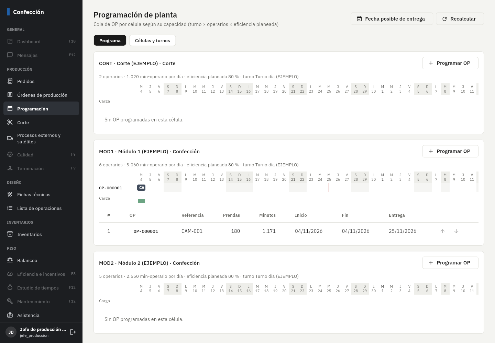
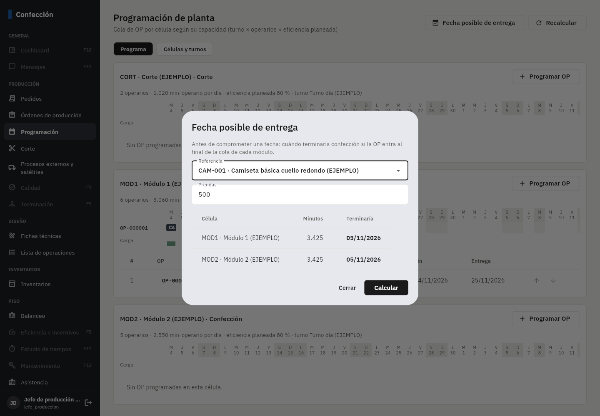
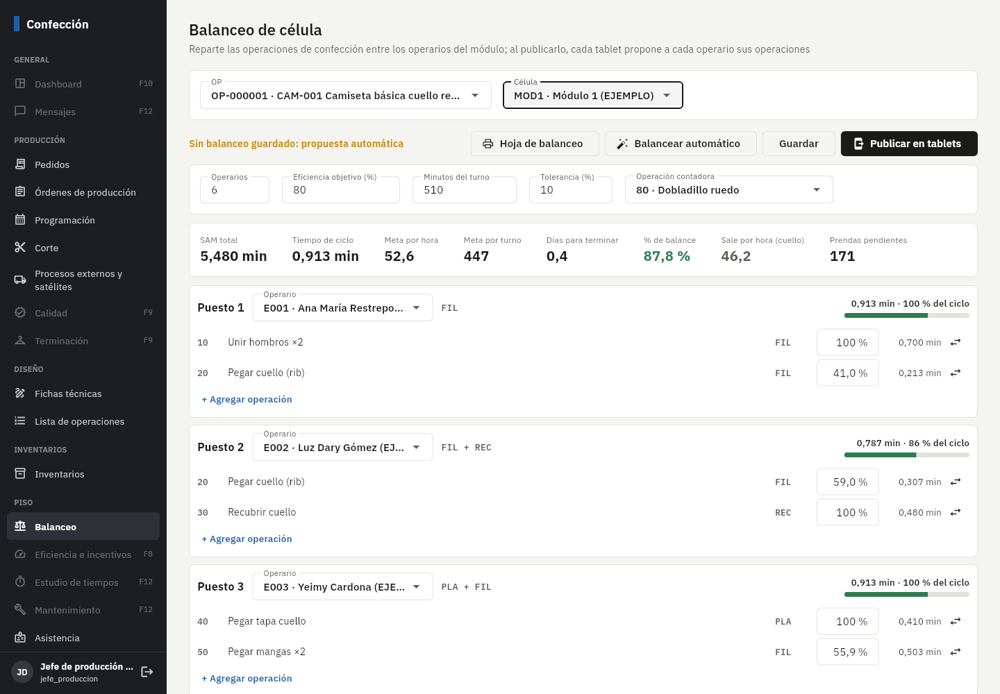
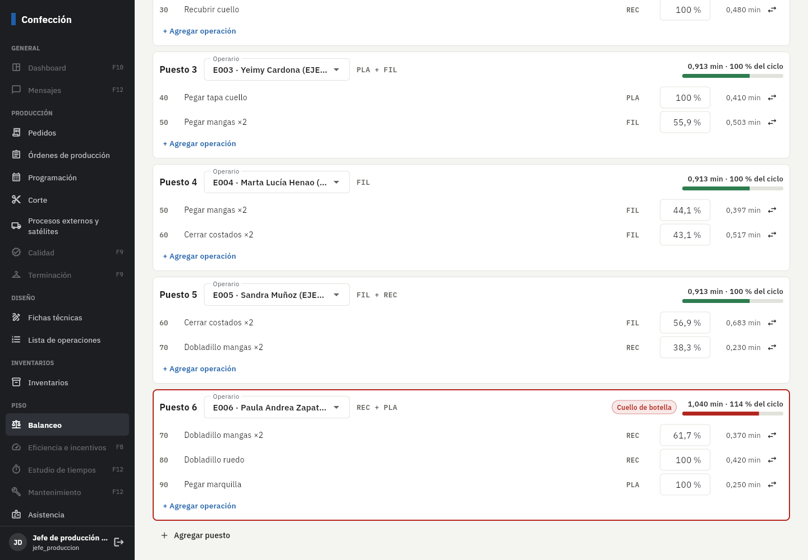
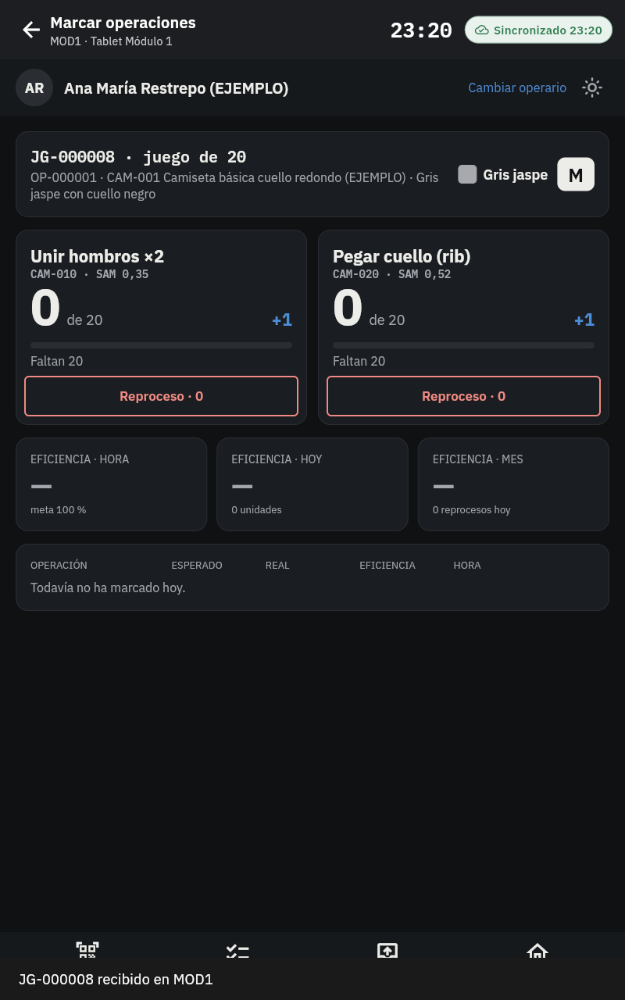

# Fase 7: células, turnos, balanceo y programación de planta

**Estado:** terminada el 5/nov/2026. Falta tu revisión.

## Qué incluye

| Parte | Detalle |
|---|---|
| Células y turnos | En *Programación → Células y turnos*: turno de cada célula, **días laborales** (L a D), **eficiencia planeada** y operarios (los empleados activos de la célula, o un número fijo). Turnos con sus **minutos de pausa**. Festivos (ya vienen los de EJEMPLO; se agregan y quitan). Mover operarios entre células. |
| Capacidad | Minutos-operario por día = (fin − inicio − pausas del turno) × operarios. Cero en festivos y días no laborales. |
| Programación | Cola de OP por célula: se agrega una OP, se sube o baja en la cola. Minutos requeridos = prendas pendientes × SAM del proceso / eficiencia planeada. Inicio y fin se calculan día por día con la capacidad. **Gantt** de 6 semanas (fines de semana y festivos en gris, línea roja = fecha de entrega, barra roja = OP que termina después de la entrega) y **carga vs capacidad** de cada día. Se recalcula al cambiar la cola y con *Recalcular*. |
| Fecha posible de entrega | Referencia y cantidad → en qué fecha terminaría confección en cada módulo si entra al final de su cola. No guarda nada: es para responder al cliente antes de comprometerse. |
| Balanceo de célula | Por OP y célula: operarios, eficiencia objetivo, minutos del turno, tolerancia y operación contadora. Muestra SAM total, **tiempo de ciclo**, **meta por hora** (60 × operarios × eficiencia / SAM), meta por turno, **días para terminar**, carga por puesto, **cuello de botella** y **% de balance**. |
| Balanceo automático | Reparte las operaciones en orden de secuencia hasta el tiempo de ciclo (+ tolerancia) y **comparte una operación entre dos operarios** cuando no cabe completa. **Respeta la máquina**: si el puesto ya tiene el 75 % del ciclo, una operación de otra máquina pasa al puesto siguiente; las manuales caben en cualquiera. |
| Ajuste manual | Operario de cada puesto, % de cada operación, mover una operación a otro puesto, agregar operaciones o puestos. Avisa si alguna operación no suma 100 %. **Hoja de balanceo** en PDF. |
| Publicar en tablets | Al publicar, la tablet del módulo **propone a cada operario las operaciones de su puesto** (puede cambiarlas). Un balanceo publicado no se edita: un cambio crea la versión siguiente y, al publicarla, la anterior queda reemplazada. |

**Ejemplo verificado a mano:** la camiseta de EJEMPLO en confección (9 operaciones, SAM 5,48 min) con 6 operarios al 80 %: ciclo
0,913 min, meta 52,6 prendas/hora y 447 por turno de 510 min; el reparto automático deja 5 puestos al 86–100 % del ciclo y el
puesto 6 en 114 % (cuello de botella), balance 87,8 %. Es el caso de prueba que comparten la app y el servidor.

## Pruebas automáticas (todas pasan)

- **338** pruebas de base de datos (**25** nuevas): métricas de balanceo iguales a la app, minutos de turno, capacidad (lunes,
  sábado, festivo), permisos, célula de otro proceso, minutos requeridos, la segunda OP empieza cuando termina la primera, mover
  en la cola, la carga nunca pasa la capacidad, fecha posible (y sin operarios no hay fecha), publicar con una operación al 50 % o
  con un operario en dos puestos (rechazado), métricas al publicar, versiones.
- **68** pruebas de la app: reparto automático y métricas (mismo caso que el servidor), operaciones propuestas en la tablet.
- Punta a punta con Supabase y PowerSync reales: las reglas nuevas de sincronización cargan y las pruebas de la tablet siguen pasando.

En el navegador: se programó OP-000001 en el Módulo 1, se calculó la fecha posible para 500 camisetas, se hizo el balanceo
automático y se publicó; en la tablet del módulo, al escanear el juego, a Ana María (puesto 1) le aparecieron directamente sus
dos operaciones.

## Errores encontrados y corregidos al probar

- Los minutos del turno se calculaban mal cuando el turno pasa la medianoche (sumar horas a una hora "da la vuelta").
- En el Gantt el martes y el miércoles salían con la misma letra.

## Cómo probarlo paso a paso

1. Aplique migraciones y datos de ejemplo, y en PowerSync pegue el `sync/sync-rules.yaml` nuevo.
2. **Programación → Células y turnos:** revise turno, días y eficiencia de MOD1; cambie la pausa del turno y vea la capacidad.
3. **Programación → Programa:** en MOD1, *Programar OP* → OP-000001. Agregue otra OP y súbala/bájela. Mire el Gantt y la carga.
4. **Fecha posible de entrega:** CAM-001, 500 prendas → Calcular.
5. **Balanceo:** OP-000001 y MOD1 → vea la propuesta automática; cambie un % o mueva una operación; *Hoja de balanceo*;
   **Publicar en tablets**.
6. En la tablet del módulo: carnet de E001 → juego `JG-000008` → aparecen sus operaciones del balanceo.

## Capturas (datos de ejemplo)

## Pendientes y decisiones

- La capacidad usa los operarios de la célula; las **ausencias del día** (asistencia) y los paros se descuentan con la eficiencia
  (Fase 8).
- Hoy se cuenta la capacidad completa del día actual aunque ya vaya avanzado el turno.
- La programación es por célula de un proceso (confección, corte, terminación…); los procesos en satélite se siguen por remisiones.
- Regla de máquina en el reparto automático: umbral del 75 % del ciclo. Si prefieren que nunca se mezclen máquinas en un puesto,
  es un ajuste pequeño.
