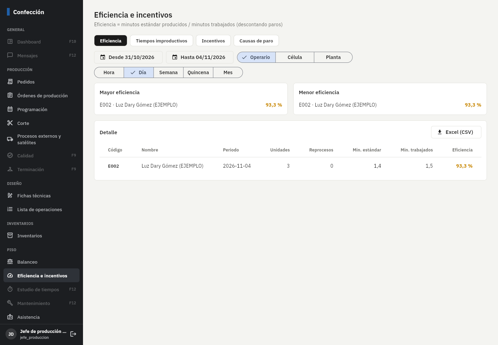
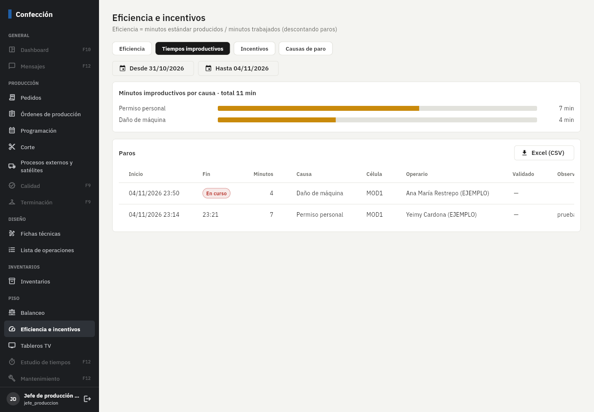
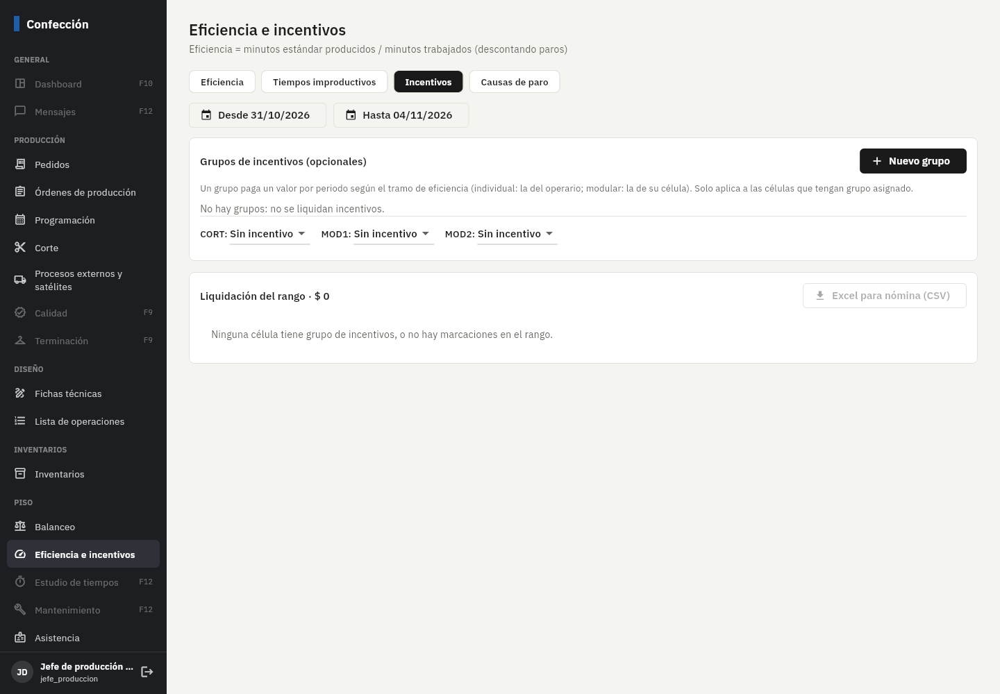
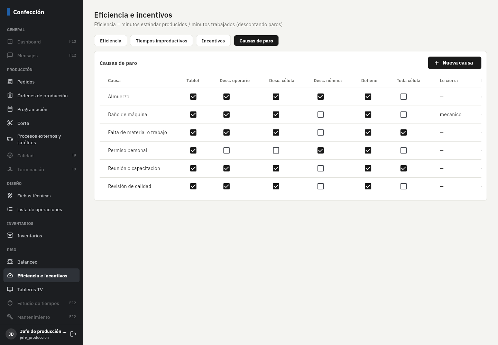
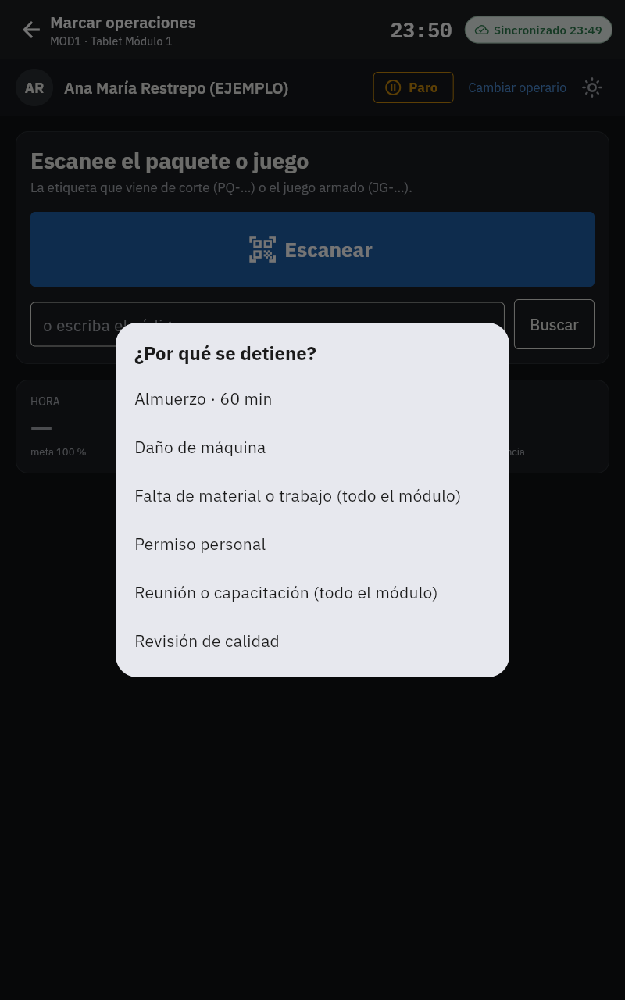
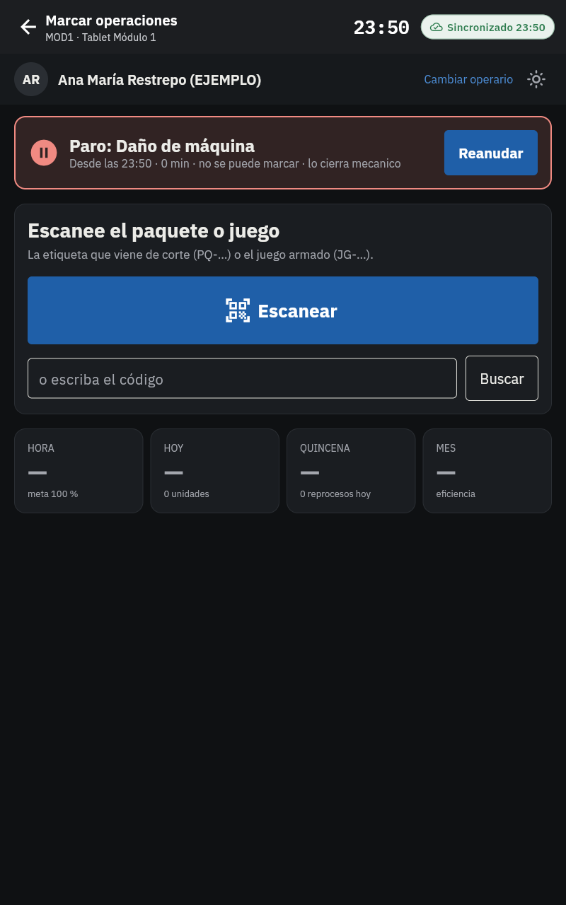
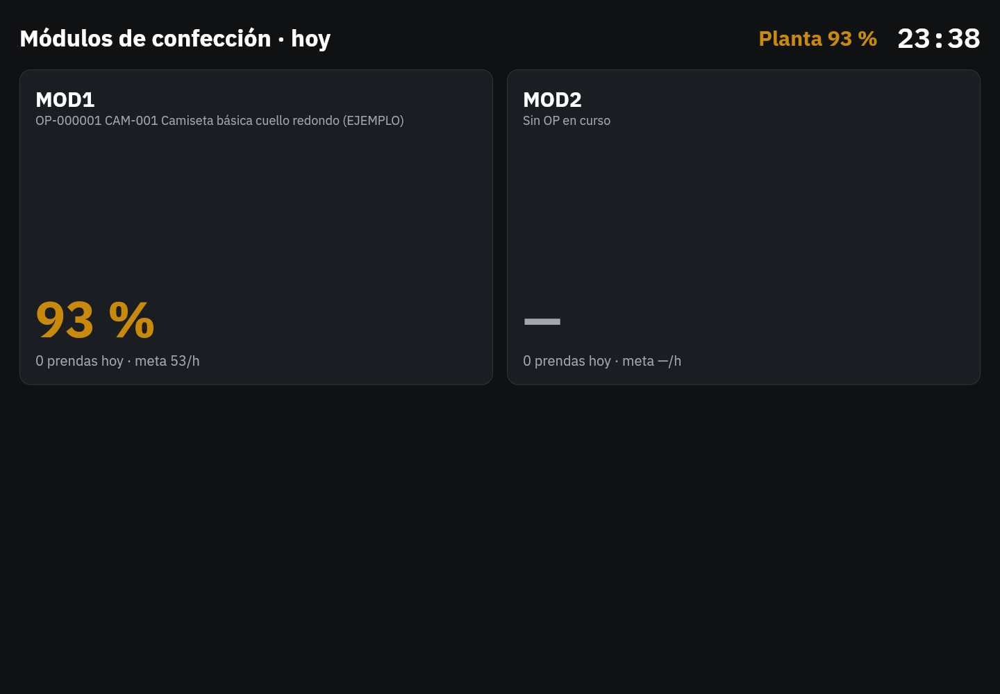
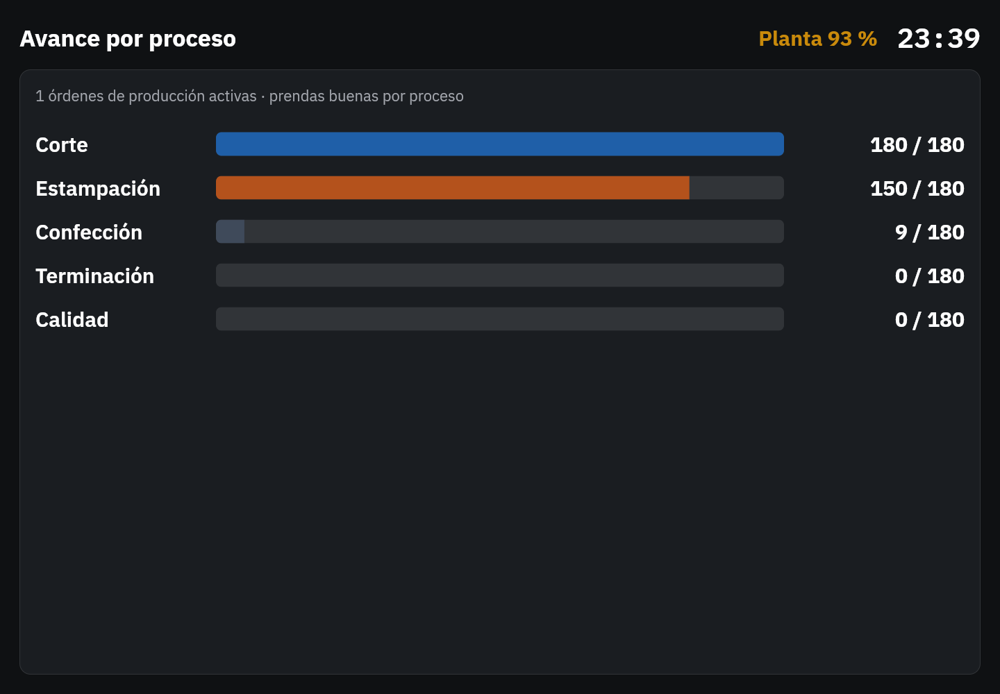
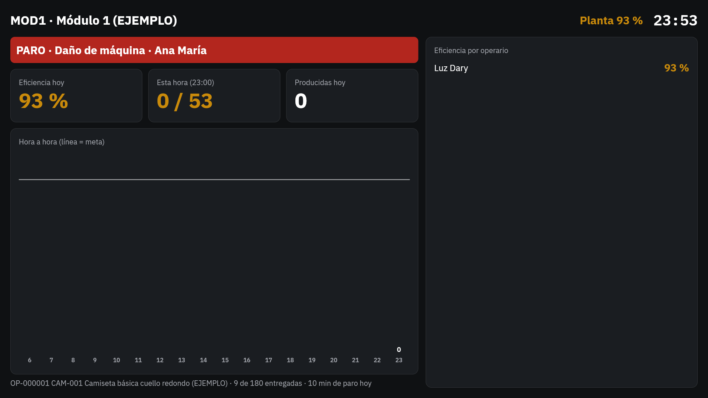

# Fase 8: eficiencia, tiempos improductivos, incentivos y tableros de TV

**Estado:** terminada el 5/nov/2026. Falta tu revisión.

## Qué incluye

| Parte | Detalle |
|---|---|
| Paros en la tablet | Botón **Paro** en la barra del operario (con o sin paquete en la mano). Se elige la causa; mientras dura sale una franja roja y **no se puede marcar** si la causa detiene el trabajo. **Reanudar** lo cierra; si la causa lo exige (p. ej. *Daño de máquina*), se escanea el carnet del **mecánico**. El almuerzo (60 min) termina solo. Funciona **sin conexión** y sube después, como las marcaciones. |
| Causas de paro | Configurables en *Eficiencia e incentivos → Causas de paro*: si aparece en la tablet, si descuenta de la eficiencia del operario y de la célula, si descuenta de nómina, si detiene el trabajo, si para **toda la célula** (p. ej. falta de material), quién lo cierra y minutos fijos. Vienen de EJEMPLO: almuerzo, daño de máquina, falta de material o trabajo, permiso personal, reunión o capacitación, revisión de calidad. |
| Eficiencia oficial | Minutos estándar producidos ÷ minutos trabajados, **descontando los paros** (la tablet y el servidor aplican la misma regla). En la tablet: cuadros HORA, HOY, QUINCENA y MES. |
| Informe de eficiencia | Por **operario, célula o planta** y por **hora, día, semana, quincena o mes**, en el rango de fechas que elija. Mayor y menor eficiencia, unidades, reprocesos, minutos de paro. **Excel (CSV)** con separador `;` para abrir directo en Excel. |
| Tiempos improductivos | Minutos por causa (barras) y detalle de cada paro: inicio, fin, célula, operario, si fue validado, observación. También en Excel (CSV). |
| Incentivos (opcional) | Grupos con **tramos de eficiencia → valor en pesos por periodo** (día, semana, quincena o mes), individual (eficiencia del operario) o modular (la de su célula) y mínimo de minutos medidos. Solo se liquida a las células que tengan grupo; **hoy ninguna lo tiene**. Liquidación del rango y **Excel para nómina**. |
| Tableros de TV | *Tableros TV*: se elige qué vistas rotan y cada cuántos segundos. **Abrir** lo pone en pantalla completa (F11 en el navegador del televisor); se actualiza cada 30 s y, si se cae la red, sigue mostrando lo último con un aviso. Vistas: **todos los módulos** (eficiencia del día, OP en curso, prendas y meta por hora), **avance por proceso** de las OP activas y **un módulo** (paro activo en rojo, eficiencia del día, prendas de esta hora contra la meta, hora a hora con la línea de meta y eficiencia de cada operario). |
| Cuenta del televisor | Rol técnico **TV**: solo ve los tableros y entra directo a ellos. Cuenta de EJEMPLO `tv-planta@planta.local`. |

La meta por hora sale del balanceo publicado (Fase 7). "Prendas" cuenta las marcaciones de la **operación contadora** del
balanceo.

## Pruebas automáticas (todas pasan)

- **379** pruebas de base de datos (**42** nuevas): un paro de 45 minutos por daño de máquina se descuenta de la marcación
  siguiente (quedan 3 minutos reales); el fin se valida con el carnet de otro empleado; un segundo fin desde otra tablet no lo
  cambia; un paro por falta de material queda para toda la célula; anular un paro exige motivo y los paros no se borran;
  eficiencia del operario con solo las marcaciones medidas; informe de paros; Bodega no ve eficiencias ni abre el tablero;
  incentivo por tramo en la quincena, sin el mínimo de minutos no hay incentivo, modular con la eficiencia de la célula;
  tablero de la célula con el paro activo, la meta por hora, la eficiencia por operario y el hora a hora; tablero de planta.
- **70** pruebas de la app: minutos reales descontando paros (el mismo cálculo que el servidor, y solo la parte del paro que cae
  dentro del intervalo); en la tablet un paro bloquea marcar, se descuenta del tiempo real y termina.
- **Punta a punta** con Supabase y PowerSync reales (nueva): la tablet **sin conexión** reporta un paro, lo cierra 7 minutos
  después, vuelve la señal, sube una sola vez y el servidor calcula los 7 minutos.

En el navegador: la tablet del Módulo 1 reportó *Daño de máquina* para Ana María y en el televisor (cuenta TV) apareció la franja
roja en la vista del módulo.

## Errores encontrados y corregidos al probar

- El informe por **hora** fallaba en la pantalla cuando una hora solo tenía la primera marcación (sin minutos todavía).
- Al cambiar de pestaña se alcanzaban a pintar filas de la pestaña anterior.
- El botón **Paro** solo salía con un paquete escaneado; ahora sale apenas el operario se identifica (un paro por falta de trabajo
  pasa justamente cuando no hay paquete).
- La lista "Avance del proyecto" de la página de inicio marcaba solo hasta la Fase 4.

## Cómo probarlo paso a paso

1. Aplique las migraciones y en PowerSync pegue el `sync/sync-rules.yaml` nuevo (agrega las causas de paro a las tablets). Cree la
   cuenta del televisor con `herramientas/crear_usuarios_demo.mjs` (o cree un usuario con el rol *Pantalla de TV*).
2. **Tablet del módulo:** carnet de un operario → **Paro** → *Daño de máquina*. Intente marcar (no deja). **Reanudar** → escanee
   el carnet de un mecánico. Pruebe también *Almuerzo* y *Falta de material* (para todo el módulo).
3. **Eficiencia e incentivos → Eficiencia:** cambie operario / célula / planta y hora / día / quincena. Descargue el Excel.
4. **Tiempos improductivos:** vea los minutos por causa y el detalle del paro que hizo.
5. **Causas de paro:** cambie algo (p. ej. que *Permiso personal* no salga en la tablet) y mírelo en la tablet.
6. **Incentivos** (solo si los usa): *Nuevo grupo* → tramos (ej. desde 80 % → $ 20.000 EJEMPLO) → asigne el grupo a MOD1 →
   mire la liquidación y descargue el Excel para nómina.
7. **Tableros TV → Editar:** elija vistas y segundos → **Abrir**. En el televisor entre con la cuenta de TV y pulse F11.

## Capturas (datos de ejemplo)

## Pendientes y decisiones

- **¿La planta paga incentivos por eficiencia?** Quedó opcional y sin ningún grupo asignado. Si no los usa, la pestaña simplemente
  no liquida nada; si los usa, dígame cómo se calculan hoy (por tramos, por punto de eficiencia, individual o por módulo) y lo ajusto.
- No hay pago a destajo (como lo pidió).
- Los paros que **descuentan de nómina** quedan marcados y salen en el Excel; el descuento lo hace nómina (integración en la Fase 11).
- El televisor necesita un navegador (Smart TV, Chromecast con Google TV o un mini PC). Si se va la red muestra lo último con un aviso.
