# Fase 9: calidad, terminación, producto terminado y segundas

**Estado:** terminada el 5/nov/2026. Falta tu revisión.

## Qué incluye

| Parte | Detalle |
|---|---|
| Tablet de calidad | El inspector escanea su carnet y el paquete o juego. **Recibir** en calidad → **Auditoría final**: la tablet dice cuántas prendas revisar al azar y con cuántas malas se aprueba; se tocan los defectos (botones grandes), se elige la operación donde nació y, si quiere, se toman las medidas de una prenda contra la ficha (✓ / ✗ por tolerancia). El resultado sale en vivo. Si se rechaza: **solo las prendas malas** o **todo el paquete a revisión**. **Entregar** solo se habilita con la auditoría aprobada. Funciona **sin conexión**. |
| Inspección en proceso | Desde la misma tablet, en el módulo o en cualquier proceso: cuántas revisó y qué encontró. Las prendas malas vuelven al operario sin frenar el paquete. |
| Devoluciones a operario y operación | Cada defecto queda a cargo del **operario que marcó esa operación** en ese paquete (sale de sus marcaciones) y de su módulo, o del satélite si el proceso fue externo. |
| Reproceso | En la tablet del módulo, al escanear un paquete devuelto, la operaria ve **"Devuelto por calidad"** con el defecto y el botón **Reproceso** de su operación. Al marcarlo, la devolución se cierra sola. El inspector también puede **recibir el arreglo** (cuántas quedaron bien y cuántas son segunda). Una nueva auditoría aprobada cierra lo pendiente. |
| Plan de muestreo | ISO 2859-1, inspección normal, nivel II, **AQL 2,5** (paquete de hasta 50: revisar 5, se aprueba con 0 malas; 51 a 150: revisar 20, aprueba con 1…). Editable por quien aprueba en Calidad. La app y el servidor usan los mismos casos de prueba. |
| Catálogo de defectos | 11 defectos comunes con el proceso donde suelen nacer y severidad (menor, mayor, crítico). Se agregan y desactivan en *Calidad → Catálogo de defectos*. |
| Eficacia (% de primera calidad) | Por **operario, módulo o satélite**: prendas revisadas de lo que hizo, prendas con defecto atribuidas, % de primera calidad, devoluciones, segundas y su defecto principal. **Pareto** de defectos. Excel (CSV). |
| Terminación | La tablet de terminación **marca operaciones** (pulir, planchar, doblar y empacar) como la del módulo. En la web: lo que está en terminación y calidad con su última auditoría, **etiquetas de prenda** con código de barras por color y talla para una OP (Zebra o PDF de 50 × 30 mm) y lo que entró esta semana. |
| Producto terminado y segundas | Cada prenda tiene su **SKU**: referencia + color/combinación + talla (`PT-CAM-001-N-M`, el mismo código de barras de la etiqueta). Las **buenas** del último proceso de la ruta entran solas a *Producto terminado*; las **segundas** de cualquier proceso entran solas a *Segundas*. En *Inventarios → Producto terminado*: existencias por referencia en cuadro color × talla, movimientos, **ajustes** (con motivo) y **traslados** entre terminado y segundas. |
| Despachos | *Inventarios → Despachos → Nuevo despacho*: se elige el pedido, salen las líneas por despachar con lo que hay en bodega, se ponen cantidades y se despacha (consecutivo **DES**). No deja despachar más de lo pedido ni de lo que hay. **Remisión en PDF** con firmas. Se puede **anular** con motivo (las prendas vuelven con un movimiento inverso). |

## Pruebas automáticas (todas pasan)

- **431** pruebas de base de datos (**52** nuevas): muestreo igual a la app en 11 casos; la segunda de confección entra a segundas
  con su SKU; terminación no entra a terminado; no se entrega desde calidad sin auditoría ni con auditoría rechazada; auditoría
  rechazada con responsable sacado de las marcaciones y alerta; no más malas que revisadas; el reproceso cierra la devolución;
  medida fuera de tolerancia = defecto de medida; cierre de devolución con cantidades que no cuadran (rechazado) y desde dos
  tablets sin conexión (no se duplica); reinspección aprobada; al entregar del último proceso las buenas entran a terminado y la
  segunda a segundas; inspección en proceso con devolución individual; anular una inspección anula sus devoluciones; inspecciones,
  movimientos y devoluciones no se editan ni se borran; despacho (permisos, no más de lo pedido, descuenta, consecutivo, anular
  con motivo devuelve); ajuste sin motivo o que deja negativo (rechazados); traslado; eficacia por operario y módulo; Pareto;
  Bodega no ve la eficacia; el satélite no ve nada de esto.
- **90** pruebas de la app (**20** nuevas): muestreo (mismos casos), medidas, prendas con defecto, auditoría sin conexión
  (rechazada y luego aprobada: manda la última), devoluciones de la tablet.
- **Punta a punta** con Supabase y PowerSync reales (nueva): la tablet de calidad baja defectos, plan y medidas; **sin conexión**
  registra una inspección con una prenda mala; vuelve la señal, sube, el servidor crea la devolución, **la devolución baja a la
  tablet**, el inspector recibe el arreglo y la devolución se cierra en el servidor y deja de bajar.

En el navegador, con datos de ejemplo: auditorías aprobadas y rechazadas, la operaria del Módulo 1 vio "Devuelto por calidad",
marcó dos reprocesos en su tablet y la devolución quedó cerrada en el servidor; un despacho DES-000001 con su remisión.

## Errores encontrados y corregidos al probar

- Cuando la entrega del módulo se registraba desde la web (sin célula), la auditoría no sabía qué módulo era el responsable:
  ahora vale la célula de la recepción.
- La tablet manda las listas de defectos y medidas como texto; el servidor ahora acepta ambas formas.
- Tablas de la web que se salían de la pantalla y casillas de selección que sobraban.

## Cómo probarlo paso a paso

1. Aplique las migraciones y en PowerSync pegue el `sync/sync-rules.yaml` nuevo (agrega calidad). Cree las tablets de calidad y
   terminación con `herramientas/crear_usuarios_demo.mjs` (`tablet-cal@planta.local`, `tablet-term@planta.local`) y el usuario
   `calidad@ejemplo.co`.
2. Pase un juego por confección y terminación (tablets o *Órdenes de producción*).
3. **Tablet de calidad:** carnet E015 → el juego → **Recibir** → **Auditoría final** → toque *Puntada saltada* → elija la
   operación → **Guardar** → *Solo las prendas malas*. Intente **Entregar** (no deja).
4. **Tablet del módulo:** carnet de la operaria que hizo esa operación → el mismo juego → **Reproceso**.
5. **Tablet de calidad:** nueva **Auditoría final** sin defectos → **Entregar**: las buenas entran a producto terminado.
6. **Web:** *Calidad* (inspecciones, devoluciones, eficacia, plan); *Terminación* (etiquetas de una OP);
   *Inventarios → Producto terminado* (cuadro color × talla, ajuste, traslado); *Inventarios → Despachos* (nuevo, PDF, anular).

## Capturas (datos de ejemplo)

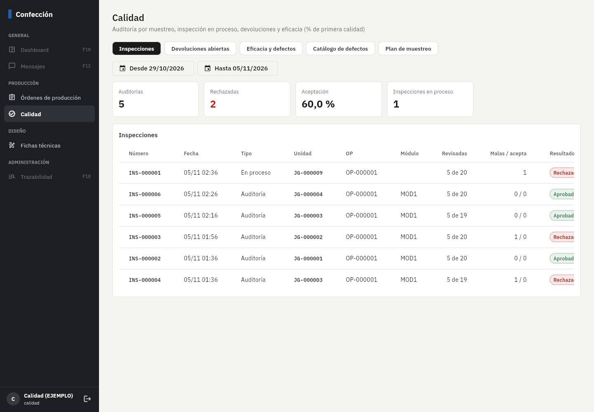
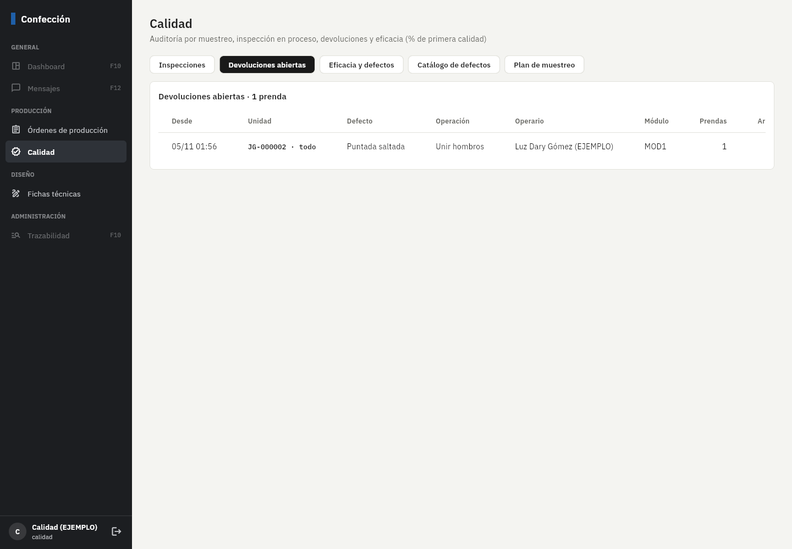
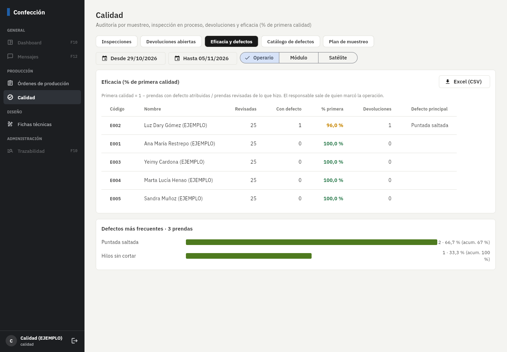
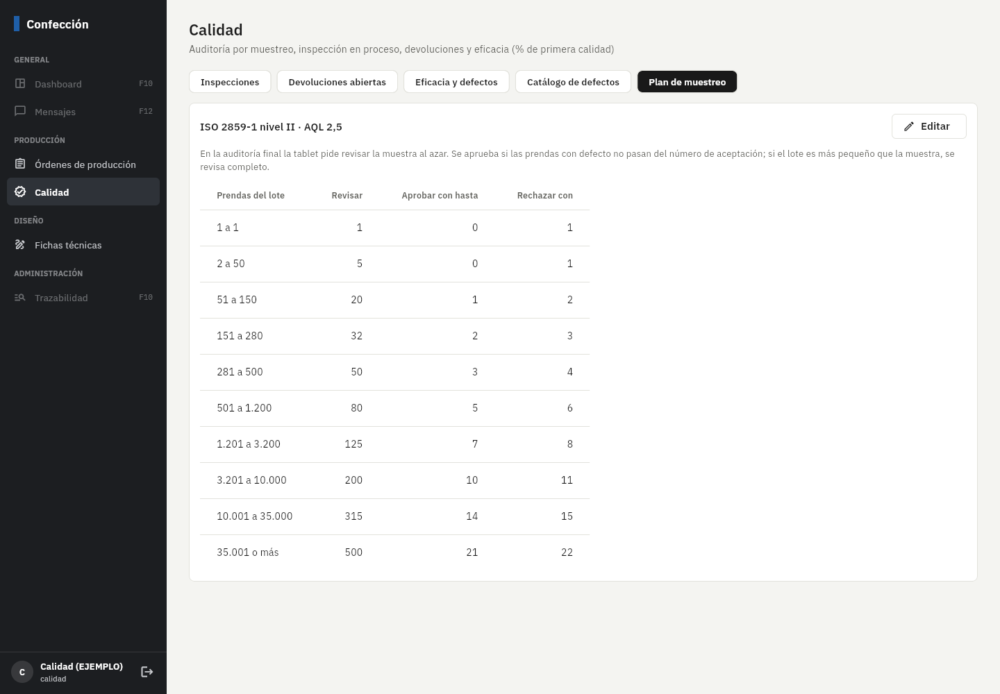
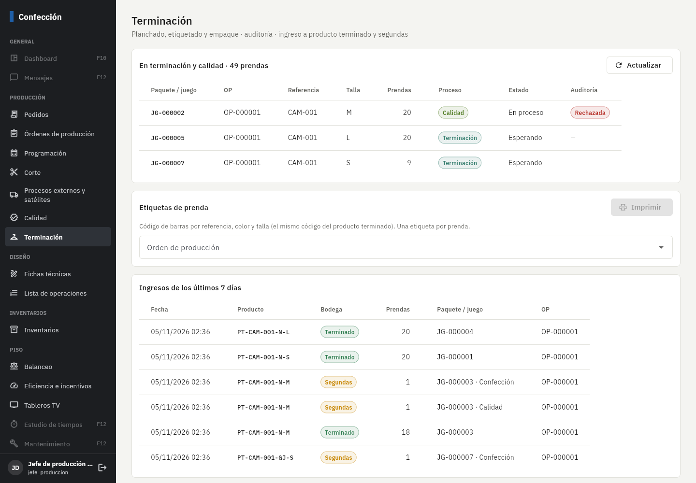
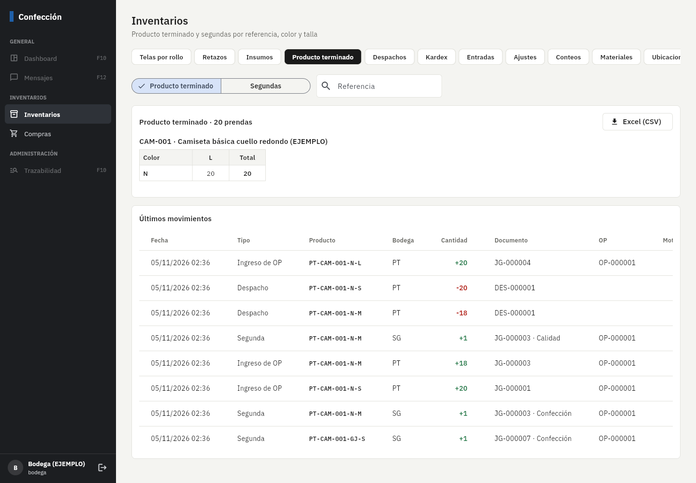
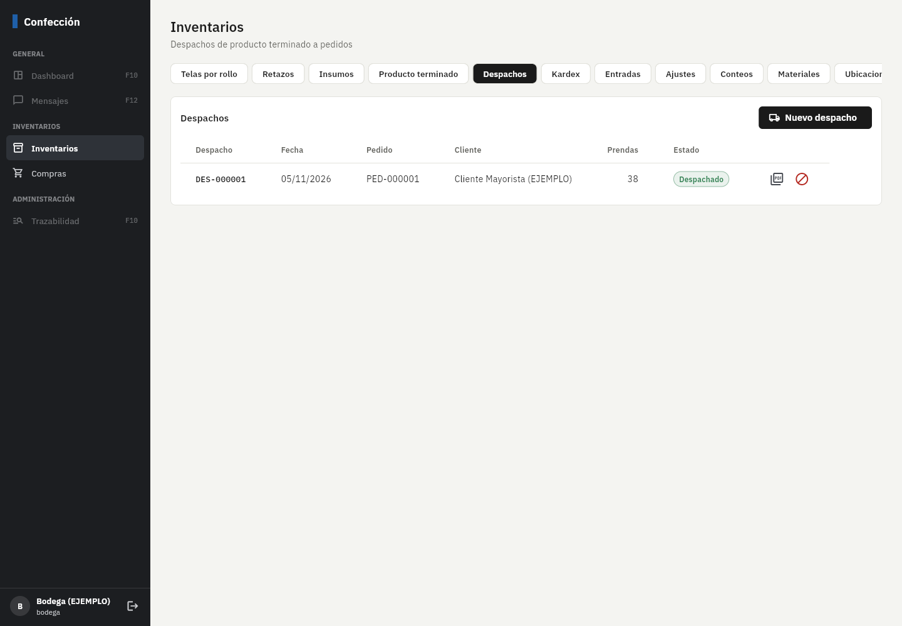
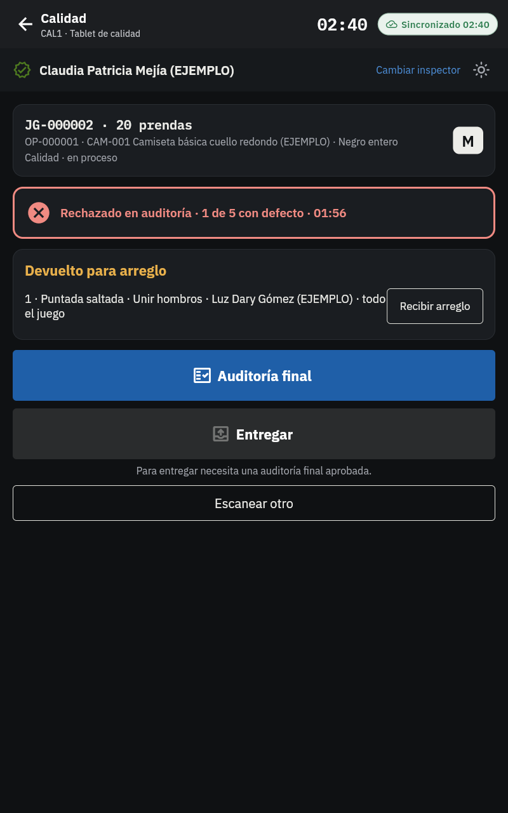
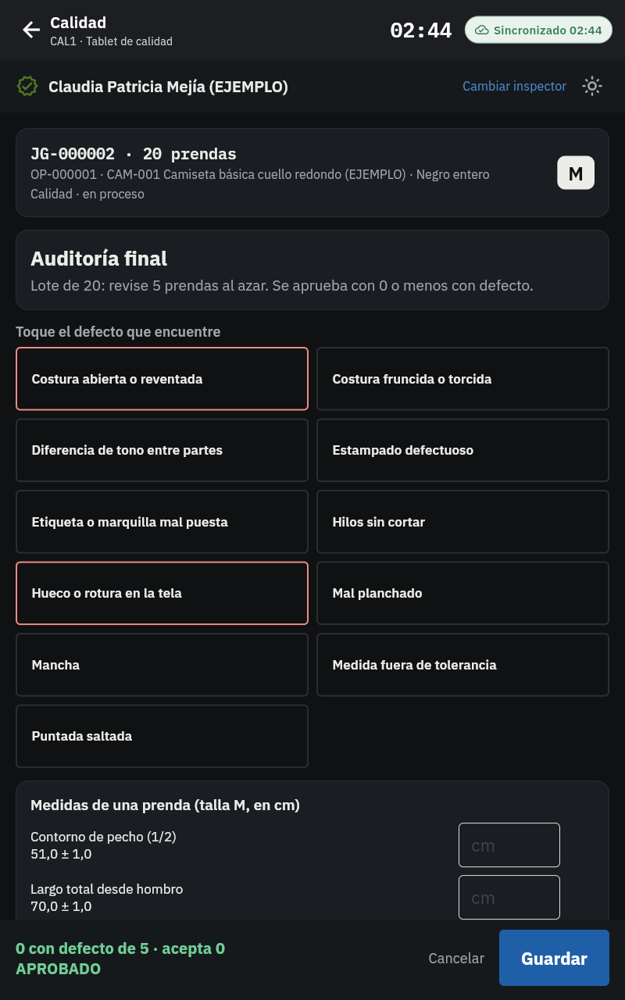
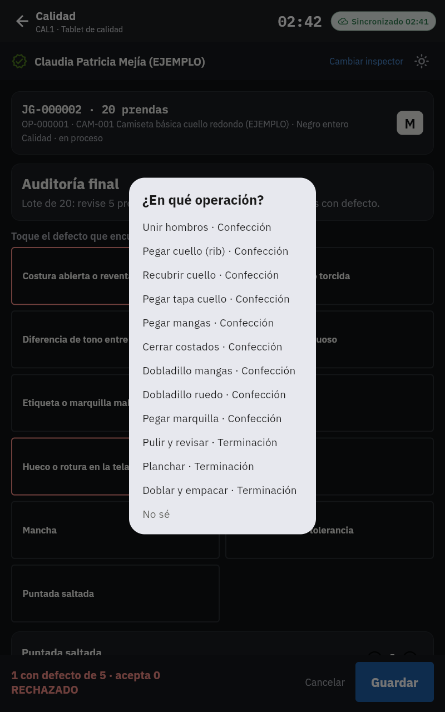
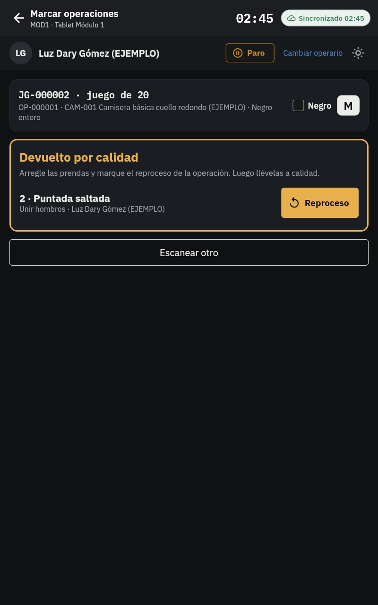

## Pendientes y decisiones (dígame si cambia algo)

- **Orden de la ruta:** en el ejemplo la ruta es confección → terminación → **calidad** (auditoría al final, luego a bodega). Si
  en su planta calidad va **antes** de terminación, basta con cambiar la ruta de la ficha; el ingreso a producto terminado
  siempre ocurre al salir del **último** proceso de la ruta.
- **La auditoría es por paquete o juego** (el lote = lo que trae la etiqueta). Si prefieren auditar por **lote de OP** (varios
  paquetes juntos), se puede agregar.
- **AQL 2,5** es un valor común en confección; si su cliente exige otro (p. ej. 1,5 o 4,0), se cambia la tabla en *Plan de muestreo*.
- Las segundas que salen en procesos intermedios (p. ej. en confección) entran a *Segundas* tal como están en ese momento.
- El avance manual por OP sin paquetes (opción antigua de *Órdenes de producción*) no mueve producto terminado; el ingreso es
  por paquete o juego.
- El despacho no factura: la factura en Alegra y los pedidos de Shopify/B2B llegan en la Fase 11 (los SKU ya tienen campos para
  sus códigos).
